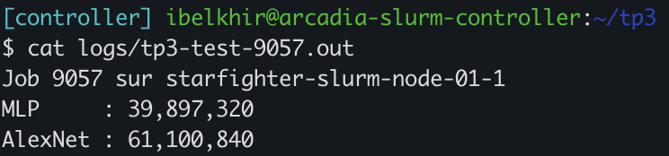
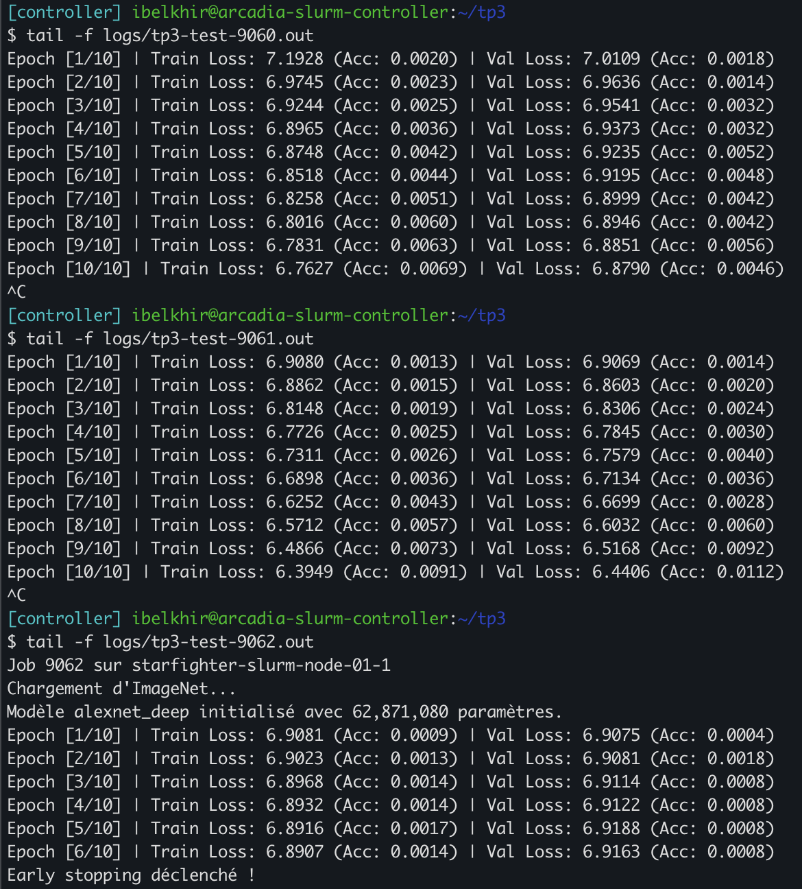
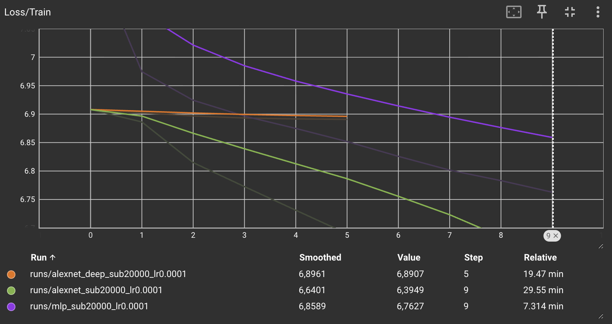
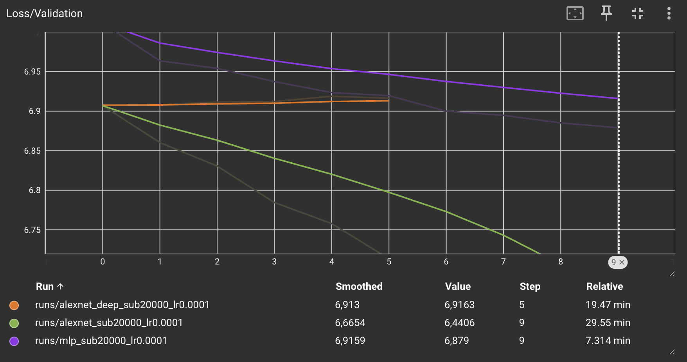
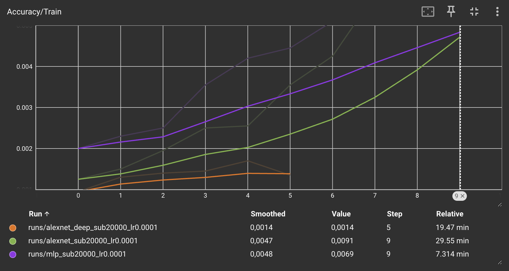
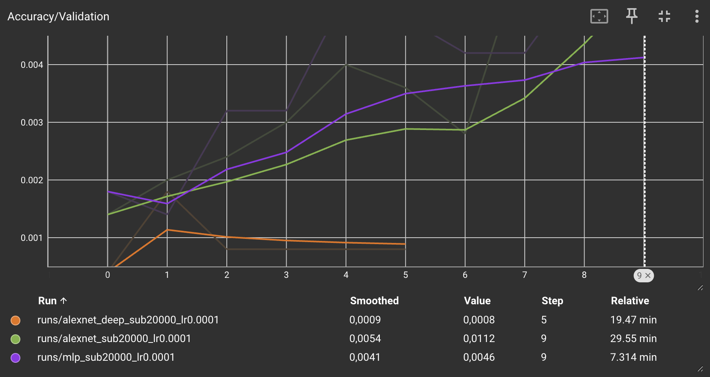
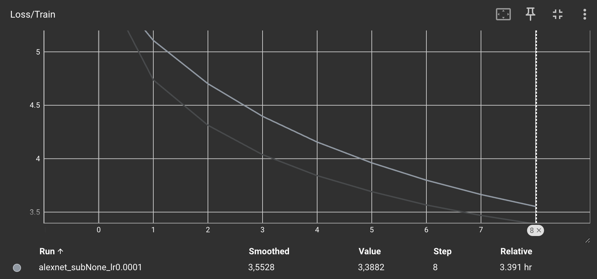
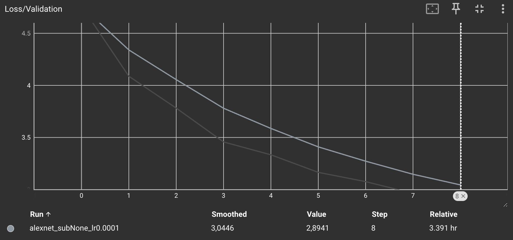
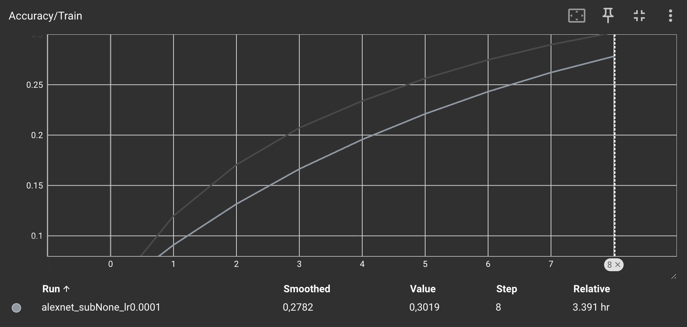
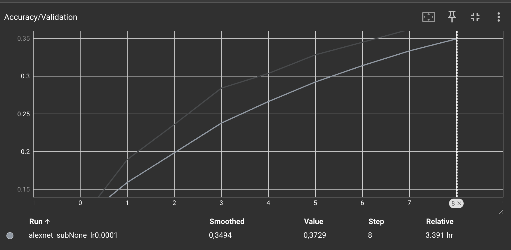

# TP3 — Réseaux convolutifs

---

## Exercice 1 : Préparation d'ImageNet et augmentation de données

### 1. Que se passe-t-il mathématiquement et numériquement lors de la descente de gradient si l'on oublie l'étape `transforms.Normalize` ? Pourquoi les statistiques (moyenne et écart-type) doivent-elles être calculées uniquement sur le jeu d'entraînement ?

Sans normalisation, les pixels sont dans [0, 1], donc tous positifs. Comme ∂L/∂wᵢ = δ·xᵢ, les gradients d'un même neurone ont tous le même signe. La descente avance en zig-zag et converge lentement. De plus, les initialisations Xavier et Kaiming supposent des entrées centrées : sans normalisation, les gradients risquent d'exploser ou de disparaître.

On calcule les statistiques sur le train seul pour éviter une fuite de données. La validation doit rester des données jamais vues.

### 2. Pourquoi utilise-t-on `RandomResizedCrop` et `RandomHorizontalFlip` sur le jeu d'entraînement, mais `Resize` + `CenterCrop` (sans flip) sur le jeu de validation ?

En train, l'augmentation aléatoire montre une version différente de chaque image à chaque époque. Le modèle devient robuste à l'échelle, à la position et à la symétrie. C'est une forme de régularisation.

En validation, on veut seulement mesurer. Le prétraitement doit être déterministe pour que les résultats soient comparables d'une époque à l'autre, sinon l'early stopping n'est plus fiable.

### 3. Donnez un exemple de tâche de classification d'images où l'augmentation par `RandomHorizontalFlip` serait néfaste et fausserait les étiquettes.

Le flip est néfaste dès que la gauche et la droite changent la classe. Par exemple, un panneau « tourner à gauche » devient « tourner à droite ». De même, un « b » devient un « d » en reconnaissance de caractères.

---

## Exercice 2 : Étude théorique et implémentation des architectures (MLP vs AlexNet)

### 2.a. Calculez à la main le nombre exact de paramètres de ce MLP (en comptant les biais, puis sans les biais). Quelle couche concentre plus de 99 % des paramètres ?

Entrée aplatie : 3 × 227 × 227 = 154 587.

| Couche | Poids | Biais | Total |
|---|---|---|---|
| Linear1 (154 587 → 256) | 39 574 272 | 256 | 39 574 528 |
| Linear2 (256 → 256) | 65 536 | 256 | 65 792 |
| Linear3 (256 → 1000) | 256 000 | 1 000 | 257 000 |
| **Total** | **39 895 808** | 1 512 | **39 897 320** |

On obtient **39 897 320** paramètres avec les biais et **39 895 808** sans. La première couche concentre **99,2 %** des paramètres.

### Outre ce nombre élevé de paramètres en entrée, quel est le défaut structurel majeur du MLP lorsqu'on lui fournit une image aplatie (flatten) ?

Le `flatten` fait perdre la structure spatiale de l'image. Le MLP ne sait pas quels pixels sont voisins. Un objet décalé de quelques pixels active des poids différents, donc chaque motif doit être réappris à chaque position.

### 2.b. Recopiez et complétez l'intégralité de ce tableau en format Markdown dans votre rapport. Pour la colonne Mémoire sortie (KB), calculez la mémoire occupée par les activations de sortie de chaque couche pour une seule image en supposant des flottants 32 bits (4 octets, 1 KB = 1024 octets).

| Couche | Entrée (C, H×W) | Hyperparamètres | Sortie (C, H×W) | # Paramètres | Mémoire sortie (KB) |
|---|---|---|---|---|---|
| Conv1 + ReLU | 3, 227×227 | 64, 11×11, S=4, P=2 | 64, 56×56 | 23 296 | 784 |
| MaxPool1 | 64, 56×56 | 3×3, S=2, P=0 | 64, 27×27 | 0 | 182,25 |
| Conv2 + ReLU | 64, 27×27 | 192, 5×5, S=1, P=2 | 192, 27×27 | 307 392 | 546,75 |
| MaxPool2 | 192, 27×27 | 3×3, S=2, P=0 | 192, 13×13 | 0 | 126,75 |
| Conv3 + ReLU | 192, 13×13 | 384, 3×3, S=1, P=1 | 384, 13×13 | 663 936 | 253,5 |
| Conv4 + ReLU | 384, 13×13 | 256, 3×3, S=1, P=1 | 256, 13×13 | 884 992 | 169 |
| Conv5 + ReLU | 256, 13×13 | 256, 3×3, S=1, P=1 | 256, 13×13 | 590 080 | 169 |
| MaxPool3 | 256, 13×13 | 3×3, S=2, P=0 | 256, 6×6 | 0 | 36 |
| Flatten + Dropout | 256, 6×6 | p = 0,5 | 9 216 (1D) | 0 | 36 |
| Linear1 + ReLU + Dropout | 9 216 | 4096, p = 0,5 | 4 096 | 37 752 832 | 16 |
| Linear2 + ReLU | 4 096 | 4096 | 4 096 | 16 781 312 | 16 |
| Linear3 (Sortie) | 4 096 | 1000 | 1 000 | 4 097 000 | 3,91 |
| **Total** | | | | **61 100 840** | **≈ 2 339** |

Formules utilisées :
- taille de sortie : H' = ⌊(H − K + 2P) / S⌋ + 1 ;
- paramètres d'une convolution : C_out × (C_in × K² + 1) ;
- mémoire : C × H × W × 4 / 1024.

### Dans AlexNet, où se concentre l'essentiel des paramètres (poids) ? À l'inverse, où se concentre l'essentiel de la mémoire des activations ?

Les paramètres sont dans les couches denses : 96 % du total, dont 37,8 M pour la première couche après le `Flatten`. Les convolutions n'en ont que 2,5 M.

La mémoire des activations est dans les premières couches, où la résolution spatiale est la plus grande. Conv1, Pool1 et Conv2 représentent 65 % du total.

### Comparez la mémoire totale des activations d'AlexNet (environ 2340 KB par image) avec celle du MLP de l'étape 1. Expliquez ce paradoxe alors que les deux réseaux ont un ordre de grandeur similaire en nombre de paramètres.

Le MLP ne produit que 1 512 activations, soit environ 5,9 KB, contre 2 340 KB pour AlexNet (400 fois plus).

Dans une couche dense, chaque poids ne sert qu'une fois. Une convolution applique le même filtre à toutes les positions de l'image : avec peu de poids, elle produit de grandes cartes de caractéristiques. Ces cartes doivent être stockées pour la backpropagation.

### 2.c. Vérification avec `count_parameters`

Les valeurs affichées correspondent à nos calculs.

---

## Exercice 3 : Boucle d'entraînement, Early Stopping et comparaison rapide

### 1. Quel est le rôle exact de `model.eval()` et `model.train()` vis-à-vis des couches `nn.Dropout` présentes dans AlexNet ? Que se passerait-il si l'on oubliait `model.eval()` pendant l'évaluation ?

`model.train()` active le Dropout : la moitié des activations est mise à zéro au hasard. `model.eval()` le désactive et utilise le réseau complet.

Sans `model.eval()`, on évaluerait un réseau amputé au hasard. La val loss serait bruitée, ce qui fausserait aussi l'early stopping.

### 2. Sur un jeu de données à 1000 classes équilibrées comme ImageNet, quelle est la valeur théorique de l'accuracy et de la CrossEntropyLoss à l'initialisation ? Vos premières époques sont-elles cohérentes avec ces valeurs ?

Pour un modèle qui répond au hasard, l'accuracy vaut 1/1000 = **0,1 %** et la loss vaut ln(1000) ≈ **6,91**.

| Modèle | Train Loss (ép. 1) | Val Loss (ép. 1) | Val Acc (ép. 1) |
|---|---|---|---|
| AlexNet | 6,908 | 6,907 | 0,14 % |
| AlexNet profond | 6,908 | 6,908 | 0,04 % |
| MLP | 7,193 | 7,011 | 0,18 % |

C'est cohérent. Le MLP démarre un peu plus haut : avec 154 587 entrées, ses premières prédictions sont trop confiantes, et fausses.

### 3. Comparez les courbes TensorBoard (Train/Val Loss et Accuracy) du MLP et d'AlexNet sur ce sous-ensemble de 20 000 images. Lequel apprend le mieux ? Lequel sur-apprend le plus vite et pourquoi ?

| Modèle (ép. 10) | Train Loss | Val Loss | Train Acc | Val Acc |
|---|---|---|---|---|
| MLP | 6,763 | 6,879 | 0,69 % | 0,46 % |
| AlexNet | 6,395 | 6,441 | 0,91 % | 1,12 % |

AlexNet apprend le mieux : sa val loss baisse régulièrement et sa val acc atteint 1,12 %.

Le MLP sur-apprend plus vite. Sa train acc continue de monter, mais sa val acc recule après l'époque 5. Avec 40 M de poids pour 20 images par classe, et sans Dropout, il mémorise les images au lieu d'apprendre des motifs. AlexNet résiste mieux grâce au partage de poids et au Dropout.

### 3.b. Observez les courbes de ce réseau plus profond par rapport à l'AlexNet standard. La difficulté à démarrer l'apprentissage relève-t-elle du sur-apprentissage ou du sous-apprentissage ? Comment l'expliquez-vous du point de vue de la propagation du gradient ?

Le réseau profond (courbe orange) n'apprend presque rien. Sa train loss reste vers 6,89 et l'early stopping s'arrête à l'époque 6.

C'est du sous-apprentissage, puisque même la loss d'entraînement ne baisse pas.

On l'explique par le vanishing gradient. À chaque couche traversée, le gradient est multiplié par les poids et les dérivées des activations. Avec trois couches de plus, et sans BatchNorm ni connexion résiduelle, il devient trop faible pour faire apprendre les premières couches.

---

## Exercice 4 : Lancement et analyse d'un entraînement long via sbatch

### 1. Profilage temporel et matériel : combien de temps dure exactement une époque complète sur les 1,28 million d'images d'entraînement avec votre GPU ? À cette vitesse, combien d'heures faudrait-il pour compléter 100 époques sans Early Stopping ?

Sur un GPU NVIDIA L4, l'entraînement d'une époque dure **24 min 15 s**, soit environ 25 min avec la validation. Pour 100 époques, il faudrait donc environ **42 h**.

### 2. Analyse de l'entraînement au fil de l'eau : courbes sur le dataset complet et comparaison de l'écart Loss/Train – Loss/Validation avec le sous-ensemble de 20 000 images. Pourquoi le sur-apprentissage est-il beaucoup plus faible ici ?

| Run | Époque | Train Loss | Val Loss | Val Acc |
|---|---|---|---|---|
| 20 000 images | 10 | 6,40 | 6,44 | 1,1 % |
| ImageNet complet | 9 | 3,39 | 2,89 | 37,3 % |

Sur le sous-ensemble, la val loss dépasse la train loss et l'écart se creuse. Sur ImageNet complet, les deux courbes descendent ensemble, sans écart qui se creuse.

Avec 64 fois plus d'images, et une augmentation différente à chaque époque, le modèle ne peut plus mémoriser les exemples. Il doit apprendre des motifs qui se généralisent.

### 3. Observation surprenante : lors des premières époques, la perte de validation est souvent inférieure à la perte d'entraînement. Donnez deux raisons techniques liées à notre code.

On l'observe à l'époque 9 : la val loss vaut 2,89 et la train loss 3,39.

1. **Le Dropout** est actif en train, ce qui dégrade les prédictions. Il est désactivé en validation.
2. **L'augmentation** rend les images d'entraînement plus difficiles (recadrage, flip). En validation, l'image est simplement centrée.