# TP4 — Réseaux récurrents et génération de séquences
---

## Exercice 1 : Exploration et Prétraitement des partitions ABC

## Étape 1 : Chargement et découverte

**1. Exécutez ce code et indiquez dans votre rapport le nombre exact de partitions présentes dans train.json et dans validation.json.**

### Taille du jeu de données
- `train.json` : **214 122** partitions
- `validation.json` : **2 162** partitions (≈ 1 % du total)

### Première partition (train_data[0])
​```
X:1
L:1/8
M:4/4
K:Emin
|: E2 EF E2 EF | DEFG AFDF | E2 EF E2 B2 |1 efe^d e2 e2 :|2 efe^d e3 B |: e2 ef g2 fe |
 defg afdf |1 e2 ef g2 fe | efe^d e3 B :|2 g2 bg f2 af | efe^d e2 e2 ||
​```

**2. Copiez le texte de la première partition (train_data[0]["abc notation"]) et collez-le dans le lecteur interactif ABC Player pour voir la partition et l'écouter. En observant le texte brut, identifiez et expliquez le rôle des métadonnées d'en-tête présentes sur les premières lignes avant le début des notes.**

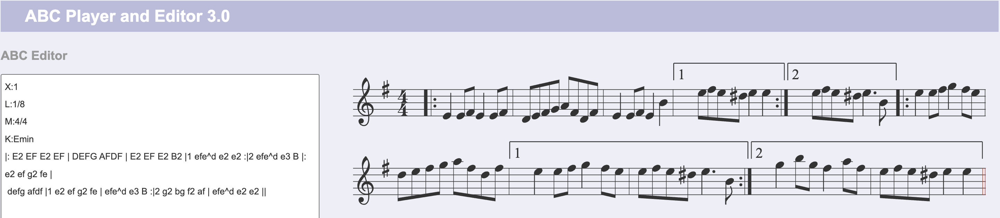

### Rôle des métadonnées d'en-tête : 
Les quatre premières lignes sont des champs `clé:valeur` qui ne produisent aucun son mais définissent comment interpréter le corps de la partition.

## Étape 2 : Construction du vocabulaire et Padding

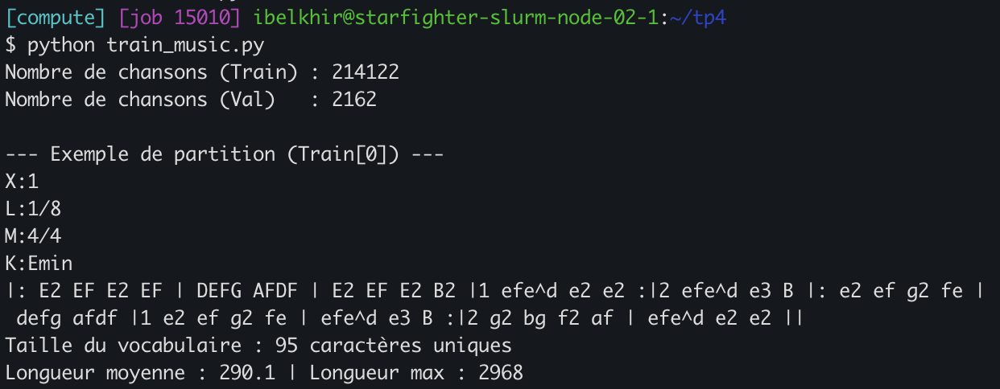

**Combien y a-t-il de caractères uniques (vocab_size) ? Quelle est la longueur moyenne et la longueur maximale d'une partition dans le jeu d'entraînement ?**

On compte 95 caractères uniques, une longueur moyenne de 290.1 et une longueur max de 2968 dans le jeu d'entrainement.

**Pourquoi est-il indispensable d'appliquer sorted(...) sur le set des caractères uniques avant de créer char_to_index ? Que se passerait-il si vous sauvegardiez les poids de votre modèle aujourd'hui et que vous relanciez votre script demain pour générer de la musique sans ce sorted() ?**

L'ordre d'un `set` de chaînes dépend du hash, randomisé à chaque lancement de Python.
Sans `sorted()`, le mapping caractère → indice change d'une exécution à l'autre.
Les poids sauvegardés correspondraient alors à d'autres caractères.

**Pourquoi avons-nous choisi de tronquer à SEQ_LENGTH = 500 (environ deux fois la longueur moyenne) plutôt que d'aligner toutes les chansons sur la longueur maximale max_len du dataset ? Quel serait l'impact d'un padding jusqu'à max_len sur le temps de calcul, la mémoire GPU et l'apprentissage du modèle ?**

Avec max_len, ~90 % de chaque séquence serait du padding (290 utiles sur 2 968) :
- **Temps** : le RNN est séquentiel, le coût est linéaire en seq_len, donc ×6.
- **Mémoire** : la BPTT stocke les activations de chaque pas de temps, donc ×6,
  ce qui oblige à réduire le batch.
- **Apprentissage** : la loss est dominée par des espaces triviaux à prédire, et
  une BPTT sur ~3 000 pas aggrave le vanishing/exploding gradient.

## Exercice 2 : Dataset PyTorch auto-régressif et Modélisation
## Étape 1 : Création du MusicDataset
**Si l'on fixe SEQ_LENGTH = 500 et BATCH_SIZE = 128, quelles sont les dimensions exactes (shapes) des tenseurs x et y renvoyés par une itération du DataLoader ? Pourquoi utilise-t-on le type torch.long (entiers 64 bits) plutôt que torch.float32 pour ces tenseurs ?**

x : (128, 499) ; y : (128, 499).
Chaque séquence de 500 caractères donne 499 entrées et 499 cibles décalées d'un pas.

Les valeurs sont des indices de caractères, pas des grandeurs continues.
- `nn.Embedding` attend des indices entiers pour sélectionner une ligne de sa matrice.
- `nn.CrossEntropyLoss` attend des cibles entières (indice de la classe correcte).
Un tenseur float32 provoquerait une erreur, et les indices n'ont aucun sens numérique
(« b » n'est pas « a + 1 » au sens musical).

**Calcul théorique des paramètres : Pour vocab_size = 95, embedding_dim = 256 et hidden_size = 512, calculez à la main le nombre exact de paramètres de chacune des trois couches (embedding, rnn, fc) lorsque rnn_type="rnn", puis lorsque rnn_type="lstm" (attention : dans PyTorch, les couches récurrentes possèdent deux vecteurs de biais b_{ih} et b_{hh} par porte !). Vérifiez votre calcul avec count_parameters. Pourquoi le bloc LSTM a-t-il exactement 4 fois plus de paramètres que le bloc RNN ?**

| Couche | Calcul | RNN | LSTM |
|---|---|---|---|
| Embedding | 95 × 256 | 24 320 | 24 320 |
| Récurrente | W_ih (512×256) + W_hh (512×512) + b_ih (512) + b_hh (512) | 394 240 | 4 × 394 240 = 1 576 960 |
| fc | 512 × 95 + 95 | 48 735 | 48 735 |
| **Total** | | **467 295** | **1 650 015** |

Vérifié avec `count_parameters` : XXX (RNN) / XXX (LSTM).

Le bloc LSTM est exactement 4× plus gros car il calcule 4 transformations affines
de même forme que celle du RNN : les portes d'entrée (i), d'oubli (f) et de
sortie (o), et la cellule candidate (g). Chacune possède ses propres W_ih, W_hh,
b_ih et b_hh.

**Pourquoi est-il bien plus pertinent d'utiliser une couche nn.Embedding en entrée plutôt que de passer directement l'indice scalaire i dans {0, ..., V-1\} dans une couche linéaire 1 -> embedding_dim} ?**

Un indice scalaire dans une couche linéaire 1 → 256 donnerait `i × w + b` :
tous les caractères seraient alignés sur une même droite, et l'ordre arbitraire du vocabulaire serait interprété comme une distance (« b » ≈ 2 × « a »).
`nn.Embedding` associe à chaque caractère un vecteur indépendant et appris (équivalent à un one-hot × matrice, mais sans calculer le one-hot) : le modèle peut placer librement les caractères similaires (ex. notes, chiffres de durée) proches les uns des autres.

**Quelle est la différence de structure entre la variable hidden_state retournée par self.rnn lorsque l'on utilise nn.RNN par rapport à nn.LSTM ? Expliquez le rôle respectif des deux états retournés par le LSTM.**

- **nn.RNN** : un seul tenseur `h_n` de forme (1, batch, 512).
- **nn.LSTM** : un tuple `(h_n, c_n)`, chacun de forme (1, batch, 512).
  - `h_n` (état caché) : sortie à court terme, utilisée par `fc` pour prédire et
    renvoyée en entrée au pas suivant.
  - `c_n` (état de cellule) : mémoire à long terme, mise à jour de façon additive
    (f ⊙ c + i ⊙ g). Ce chemin limite le vanishing gradient et permet de conserver
    longtemps l'information (métrique, tonalité, reprises ouvertes).

## Exercice 3 : Entraînement, Dynamique des Gradients et Comparaison RNN vs LSTM


**1. Manipulation des tenseurs : Pourquoi doit-on écrire logits.reshape(-1, vocab_size) et y.reshape(-1) avant d'appeler loss_fn ? Que représente la valeur numérique de la dimension obtenue à la place du -1 ?**

`nn.CrossEntropyLoss` attend des logits de forme (N, C) et des cibles de forme (N,). Nos logits sont en (batch, seq_len, vocab_size), donc on fusionne les dimensions batch et temps : chaque position devient une classification indépendante parmi 95 caractères.
Le -1 vaut batch_size × seq_len = 128 × 499 = 63 872, c'est-à-dire le nombre total de caractères à prédire dans le batch (moins pour le dernier batch incomplet).


**2. Ordre des opérations : Pourquoi la fonction clip_grad_norm_ doit-elle impérativement être appelée après loss.backward() mais avant optimizer.step() ?**

Après `loss.backward()`, car c'est là que les gradients sont calculés : avant, il n'y a rien à clipper.
Avant `optimizer.step()`, car c'est l'étape qui met à jour les poids avec les gradients : si on clippe après, la mise à jour a déjà été faite avec les gradients non limités, et le clipping ne sert à rien.

**3. Analyse expérimentale (TensorBoard) : Insérez dans votre rapport les courbes comparatives TensorBoard (Loss/Validation, Accuracy/Validation et GradNorm/step) des 3 runs :**

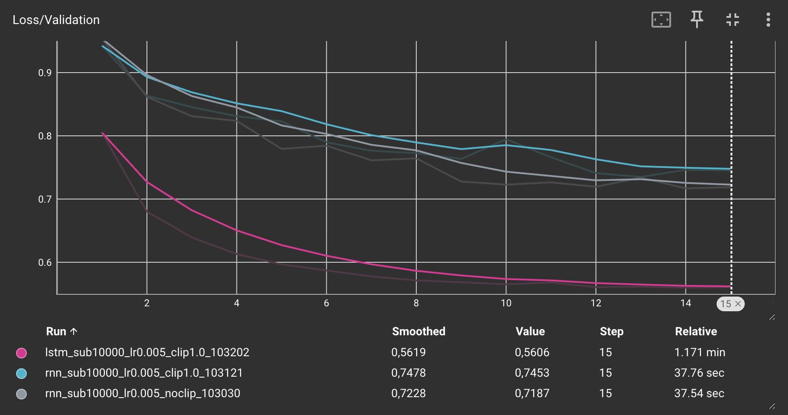
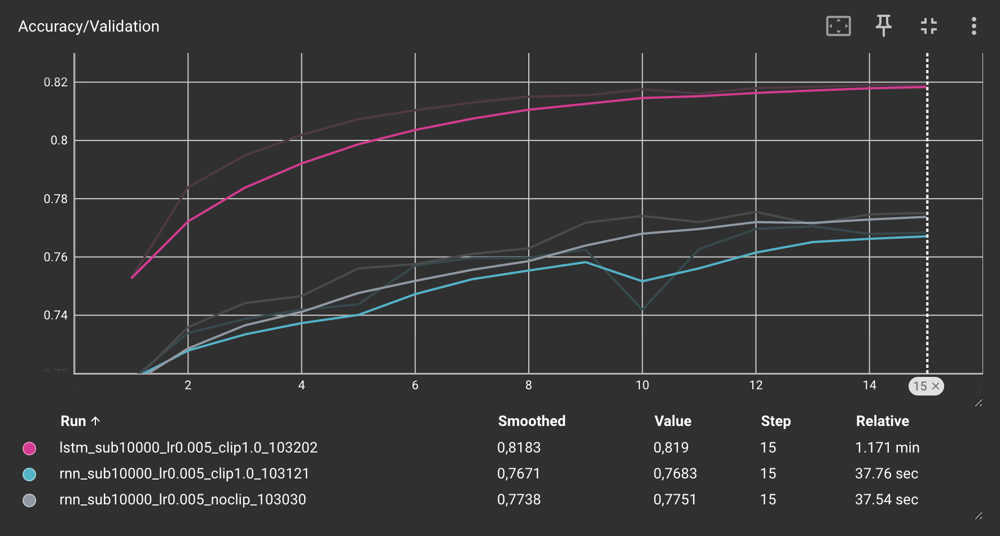
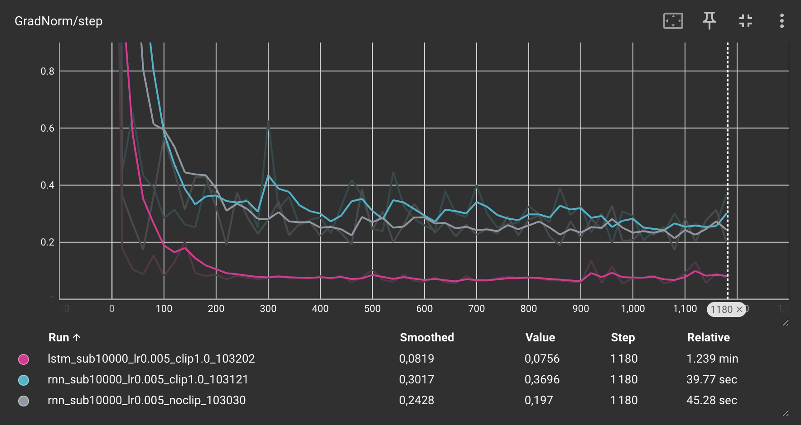

**Comparez l'évolution de la norme des gradients et la stabilité de la perte entre le Run 1 et le Run 2. Quel problème théorique du RNN simple le gradient clipping corrige-t-il ici ?**

Dans notre cas, les deux runs sont très proches : val loss finale de 0,7187 (Run 1) contre 0,7453 (Run 2), val accuracy de 0,7751 contre 0,7683. Sur GradNorm/step, la norme ne dépasse 1 que pendant les premiers steps de l'entraînement, puis elle se stabilise autour de 0,2–0,4 pour les deux runs, sans explosion. Le seuil de 1.0 n'est donc atteint qu'au tout début, et le clipping agit très peu. Les quelques instabilités observées (saut de la val loss à l'époque 10 du Run 2, pic de gradient vers le step 300) relèvent plutôt du bruit d'entraînement.

Le clipping sert à corriger l'**exploding gradient** : en BPTT, le gradient est un produit de matrices diag(tanh')·W_hh répété sur 499 pas, et si leur norme dépasse 1, il explose. Le clipping limite la norme du gradient tout en gardant sa direction. En revanche, il ne règle pas le vanishing gradient.

**Comparez les performances (vitesse de convergence, Loss et Accuracy de validation finales) entre le Run 2 (RNN) et le Run 3 (LSTM). Expliquez mathématiquement (à l'aide des portes et de l'équation de mise à jour du cell state c_t vue en cours) pourquoi le LSTM parvient à capturer des dépendances plus longues dans la partition musicale.**

Le LSTM est bien meilleur :
- Convergence : dès l'époque 2, il atteint une val loss de 0,680, déjà meilleure que le RNN après 15 époques.
- Résultats finaux : val loss de 0,5606 contre 0,7453, et val accuracy de 0,8190 contre 0,7683.
- Ses courbes sont plus lisses et sa norme de gradient est stable (~0,075).

Explication : le cell state est mis à jour par
c_t = f_t ⊙ c_{t-1} + i_t ⊙ g_t
où f_t est la porte d'oubli, i_t la porte d'entrée et g_t le candidat. On a donc ∂c_t/∂c_{t-1} = diag(f_t) : la mise à jour est additive et ne passe ni par W_hh ni par la dérivée de tanh. Si f_t ≈ 1, le gradient traverse beaucoup de pas de temps sans disparaître.
Dans le RNN, h_t = tanh(W_hh h_{t-1} + W_ih x_t), donc le gradient est multiplié à chaque pas par W_hh et tanh' ≤ 1, et il disparaît exponentiellement.
Le LSTM peut ainsi garder en mémoire des informations comme la métrique (M:), la tonalité (K:) ou une reprise ouverte (|:) sur toute la partition.

**4. Réflexion sur la métrique : Sachant qu'une partition de 250 caractères a été paddée jusqu'à 500 caractères avec des espaces ' ', pourquoi l'Accuracy/Validation affichée est-elle artificiellement optimiste quant à la capacité réelle du modèle à prédire des notes de musique ? Quelle modification simple de nn.CrossEntropyLoss permettrait de ne pas compter le padding dans la perte ?**

Dans ce cas, la moitié des positions sont du padding : après un espace de padding vient toujours un autre espace, ce qui est très facile à prédire. Ces positions comptent dans l'accuracy alors qu'elles n'ont rien à voir avec la musique, donc l'accuracy est gonflée.
On peut utiliser `nn.CrossEntropyLoss(ignore_index=PAD_IDX)` pour ignorer ces positions dans la loss. Il faut cependant un token de padding dédié, car si on ignore l'espace, on ignore aussi les vrais espaces de la partition. Il faut également appliquer le même masque à l'accuracy (`y != PAD_IDX`).

## Exercice 4 : Génération musicale, Température et Job Slurm (~35mn)
## Étape 1 : Implémentation de la génération avec propagation de l'état caché

**1. Efficacité algorithmique : Dans la boucle for ci-dessus, nous passons uniquement le dernier caractère généré [[next_index]] de taille (1, 1) tout en fournissant hidden_state au modèle. Si, au lieu de conserver hidden_state, nous avions concaténé toute la séquence générée depuis le début et repassé la séquence entière à model(full_seq, None) à chaque itération, quelle aurait été la complexité temporelle totale pour générer N caractères ? Quelle est la complexité avec notre méthode ?**

Sans hidden_state, à l'itération k on retraite toute la séquence (P + k caractères, P = taille de l'amorce). Au total, cela fait Σ (P + k) pour k de 1 à N, soit une complexité en O(N²) (O((P+N)²)).
Avec notre méthode, l'état caché h_t (et c_t) résume déjà tout le passé : on ne traite qu'un seul nouveau caractère par itération, pour un coût constant. Après la lecture de l'amorce en O(P), la génération est en **O(N)**.

**2. Rôle mathématique de la température T :**

**Que devient la distribution de probabilité softmax(z_t / T) lorsque T → 0⁺ ? À quelle stratégie de décodage cela correspond-il ?**

Quand T → 0⁺, les écarts entre logits sont amplifiés : exp(z_max/T) écrase tous les autres termes. La distribution tend vers un one-hot sur le caractère de logit maximal, ce qui correspond au greedy decoding (argmax).

**Que devient cette distribution lorsque T → +∞ ?**

Quand T → +∞, z_t/T → 0 pour tous les caractères, donc tous les exp valent 1. La distribution tend vers la loi uniforme (1/95 pour chaque caractère) : le modèle tire au hasard sans tenir compte de ce qu'il a appris.

**Écoute et analyse qualitative : À l'aide de votre meilleur modèle LSTM sauvegardé (ou après avoir lancé un entraînement plus complet à l'étape 2 ci-dessous), générez 3 partitions de 300 caractères à partir de l'amorce "X:1\nT:Irish Reel\nM:4/4\nL:1/8\nK:D\n" avec trois températures :**

T = 0.2 (basse température)
T = 0.8 (température modérée)
T = 2.0 (haute température)

**Copiez les 3 partitions générées dans votre rapport et testez-les sur ABC Player. Commentez la validité syntaxique (respect des barres de mesure, des notes ABC) et la richesse musicale (répétitions vs chaos) de chacune des trois générations.**

**T = 0.2** : la syntaxe est valide (notes de la gamme de ré, barres `|`, reprise `::`), mais la génération est très répétitive : le motif `c2 B A2 B` revient 7 fois d'affilée, ce qui est typique du greedy decoding qui tourne en boucle. Le modèle ne respecte pas non plus la métrique : les mesures font 6 croches (`c2 A A2 B` = 2+1+2+1) au lieu de 8 pour du 4/4. C'est un rythme de jig (6/8), probablement le motif le plus fréquent appris. La partie après `::` est un peu plus variée.
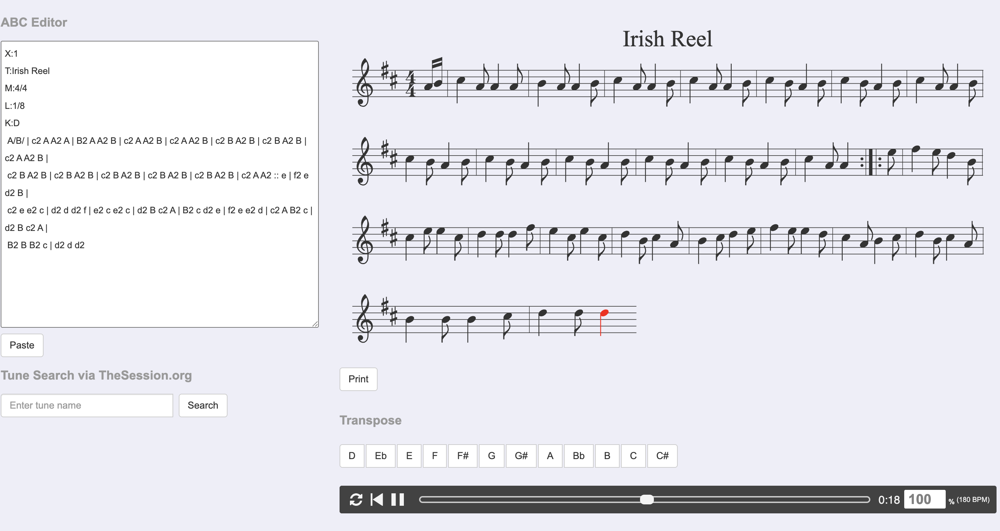

**T = 0.8** : c'est le meilleur compromis. La syntaxe ABC est respectée (barres, durées `3/2` et `/`, reprise `::`) et la mélodie est variée tout en restant cohérente avec ré majeur, avec deux parties distinctes comme dans un vrai reel. La durée des mesures reste approximative (entre 6 et 8 croches selon les mesures), mais l'air est jouable et sonne « irlandais ».
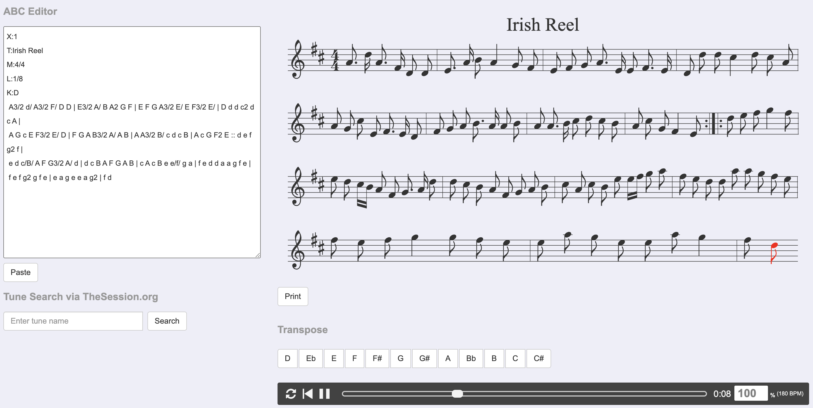

**T = 2.0** : la génération est chaotique. Elle contient des caractères qui n'ont rien à faire dans une partition (`Y`, `R`, `q`, `S`, chiffres isolés comme `879`), des crochets et parenthèses non fermés et des annotations aléatoires (`"A"`, `!OjDE)!`). La distribution est presque uniforme, donc le modèle tire n'importe quel caractère : la partition n'est pas valide et ABC Player ne peut pas l'interpréter correctement.
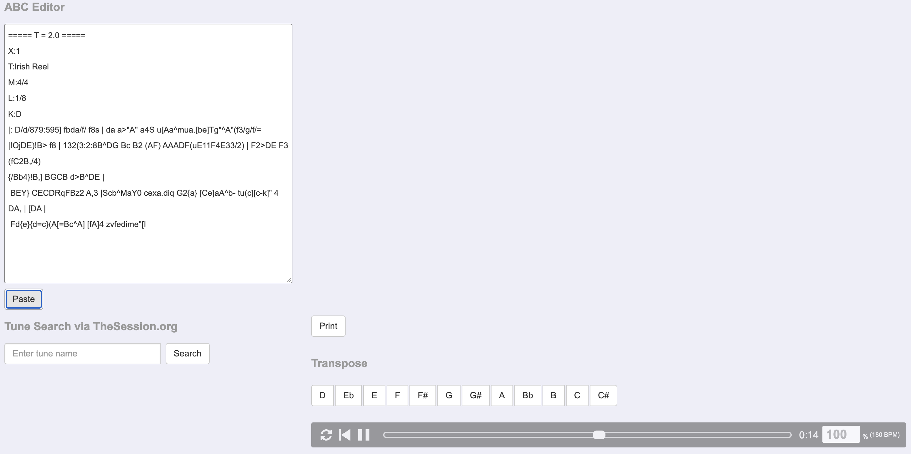
ABC Player n'arrive même pas à afficher la partition : le texte est trop invalide pour être interprété.

On retrouve bien le compromis cohérence/diversité : une T basse donne des boucles répétitives, une T haute du bruit, et T ≈ 0.8 de la musique crédible.
Remarque : l'amorce contient `T:` (titre), un champ absent du dataset IrishMAN, que le modèle n'a donc jamais vu.


## Étape 2 : Entraînement à plus grande échelle via sbatch

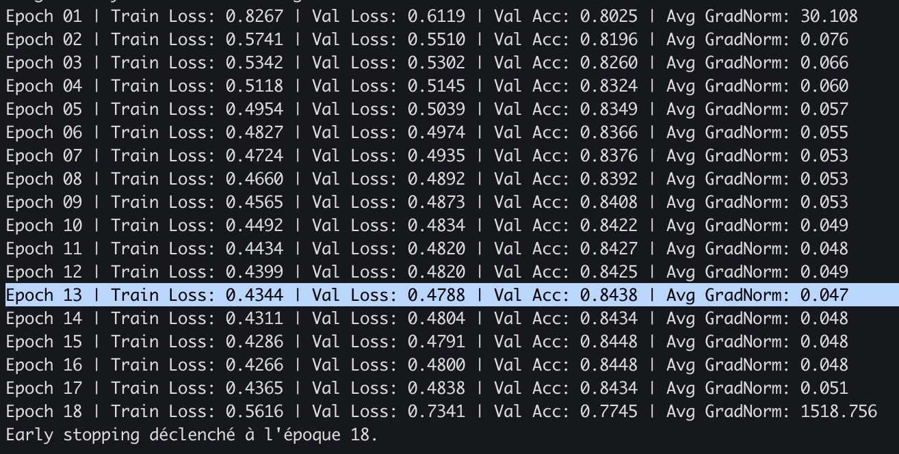
LSTM (hidden 1024, 50 000 partitions) : meilleure val loss de 0,4788 (acc 0,8438) à l'époque 13, contre 0,5597 avec le petit modèle.
À l'époque 18, la norme des gradients explose (1 518 en moyenne) et la val loss remonte à 0,73 : même avec un LSTM et du clipping, l'exploding gradient peut survenir. L'early stopping arrête l'entraînement et le meilleur modèle reste celui de l'époque 13.


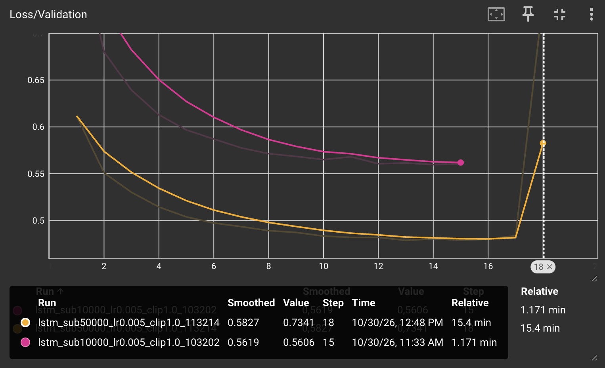
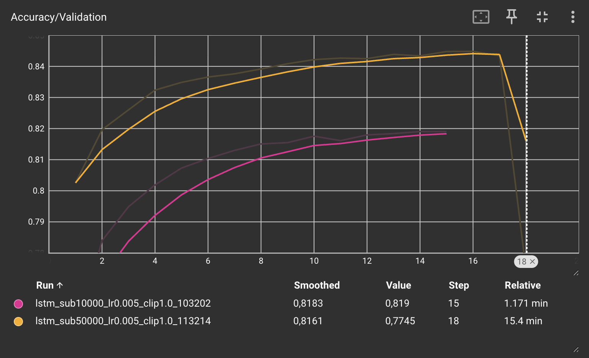
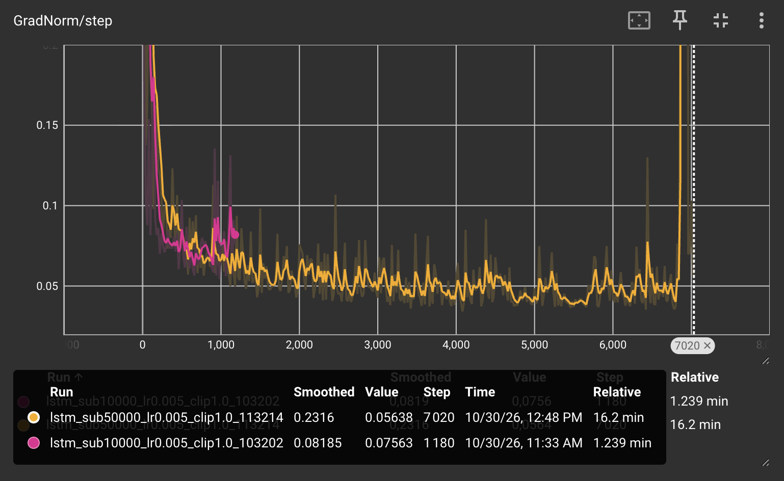

Le grand LSTM (orange) est meilleur que le petit (rose) à chaque époque. Il atteint dès l'époque 2 la loss finale du petit modèle (~0,55), mais l'entraînement est ~13× plus long (15,4 min contre 1,2 min). Sur GradNorm/step, la norme reste stable vers 0,05, puis des pics apparaissent à partir du step ~6 000 avant l'explosion vers le step 6 900.

**4.c. (Bonus facultatif) Augmentation de données musicales : En musique, transposer une mélodie d'un ou plusieurs demi-tons (ou d'une tonalité à une autre) conserve sa structure musicale tout en modifiant les caractères de notes et l'en-tête K:. Expliquez dans votre rapport comment vous pourriez implémenter une telle augmentation de données sur le format ABC et pourquoi cela réduirait le sur-apprentissage.**

Implémentation : pour chaque partition, on tire au hasard un décalage k ∈ [-5, +6] demi-tons (à la volée, dans `__getitem__`) :
1. On lit la tonalité dans `K:` pour connaître l'armure.
2. On convertit chaque note (altération `^ _ =` + lettre + octave `, '`) en hauteur absolue (numéro MIDI), en tenant compte de l'armure.
3. On ajoute k, puis on réécrit la note en ABC dans la nouvelle tonalité et on met à jour `K:` (ex. K:D + 2 → K:E).
En pratique, on peut utiliser une librairie comme `music21`, qui sait lire l'ABC et transposer.
On n'augmente que le train, pas la validation.

Pourquoi ça réduit le sur-apprentissage : on multiplie la quantité de données (jusqu'à ×12) sans changer la structure musicale (rythme, intervalles, barres). Le modèle ne peut plus mémoriser des airs précis dans une tonalité donnée : il doit apprendre des relations entre notes (intervalles, cohérence avec K:) valables dans toutes les tonalités, donc mieux généraliser.