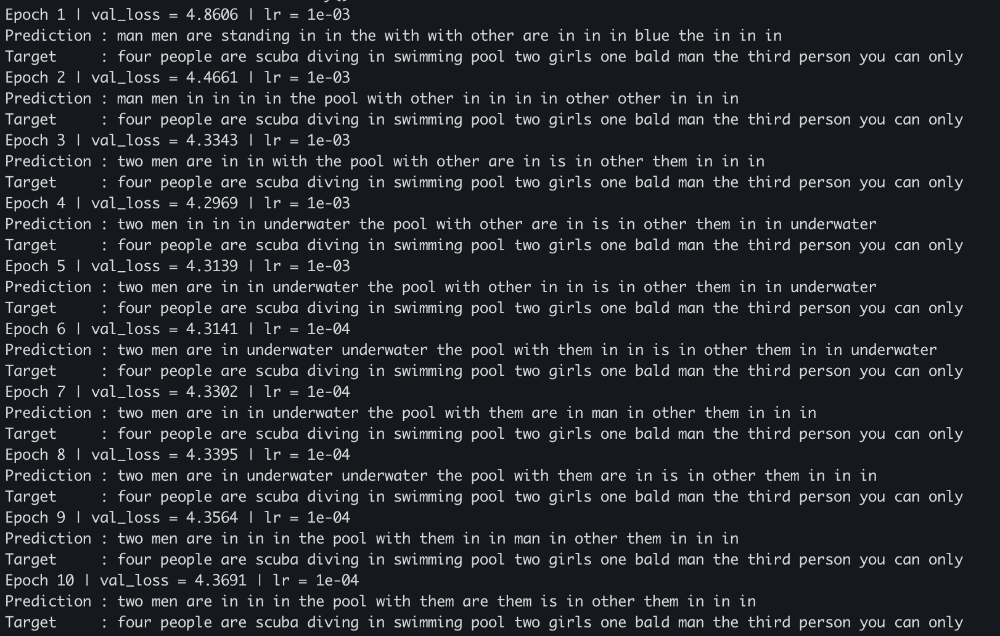
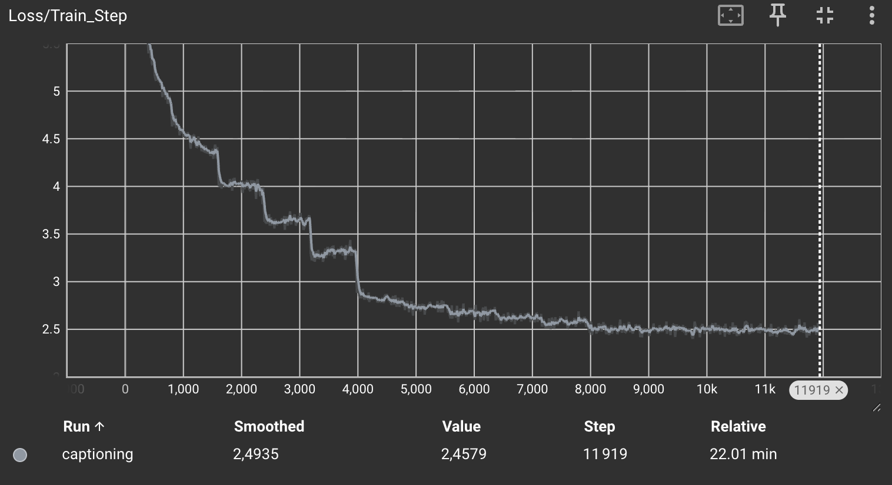
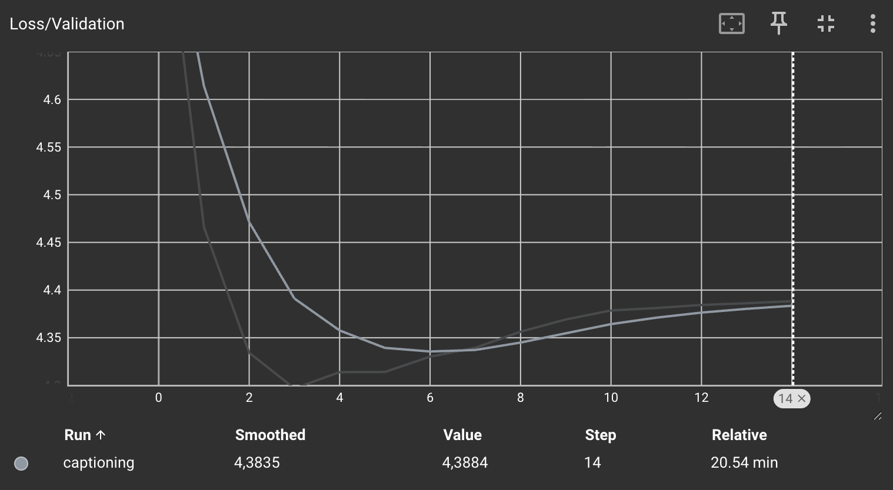
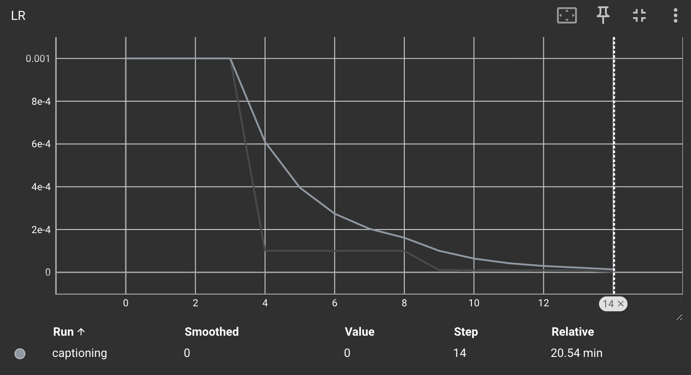

# TP5 — Image Captioning avec RNN et Attention sur ResNet
---

## Exercice 1 : Chargement des données et Embeddings (~30mn, – moyen)

## Étape 1 : Chargement et découverte

**Q1.a – Pourquoi doit-on redimensionner explicitement toutes les images à une taille fixe de (224, 224) avant de les passer dans le réseau, plutôt que de garder leur résolution d'origine ?**

- **Constitution des batchs** : le `DataLoader` empile les images en un seul tenseur `(B, 3, H, W)`. Avec des résolutions d'origine différentes car Flickr30k contient des images de tailles variées, `torch.stack` échoue : toutes les images d'un batch doivent avoir exactement la même forme.
- **Cohérence avec le pré-entraînement** : ResNet50 a été entraîné sur ImageNet en 224×224. Garder cette résolution conserve l'échelle des motifs (bords, textures, objets) que les filtres ont appris à reconnaître, ce qui est essentiel puisqu'on gèle le réseau.
- **Coût maîtrisé** : la mémoire GPU et le temps de calcul sont prévisibles et bornés, au lieu de dépendre de la plus grande image du batch.

**Rôle de `text_utils.py`**

- Construit le vocabulaire à partir des légendes de Flickr30k.
- Lit le fichier binaire Word2Vec (GoogleNews, 300 dimensions) et ne conserve que les vecteurs des mots présents dans le vocabulaire, pour créer une couche `nn.Embedding` initialisée avec ces poids pré-entraînés.
- `tokenize` convertit une légende en une séquence d'indices de longueur fixe (20) : l'indice 0 sert de début de séquence et de padding (d'où `ignore_index=0` dans la loss). `untokenize` fait l'opération inverse.

## Exercice 2 – Extraction de caractéristiques et Transfer Learning
**Pourquoi est-il crucial de geler (requires_grad = False) les poids du ResNet dans ce TP ? Donnez au moins deux raisons (une matérielle et une algorithmique).**

- Raison matérielle : sans gel, il faudrait stocker les activations intermédiaires des ~23,5 M de paramètres du backbone pour la rétropropagation, ainsi que leurs gradients et les deux moments d'Adam (soit environ 3× la taille des poids en plus). Avec le gel, la mémoire GPU nécessaire et le temps par itération chutent, ce qui permet des batchs plus grands.

- Raison algorithmique : en début d'entraînement, l'attention, le LSTM et fc_out sont initialisés aléatoirement. Les gradients qu'ils renvoient sont donc très bruités. Rétropropagés dans le ResNet, ils dégraderaient des caractéristiques visuelles génériques apprises sur 1,2 M d'images ImageNet.

**Si vous passez un tenseur image de forme (32, 3, 224, 224) (batch_size, channels, H, W) dans cnn_features, quelle sera la dimension (shape) exacte du tenseur de sortie ?**

(32, 2048, 7, 7) : le ResNet50 sans avgpool ni fc réduit la résolution spatiale d'un facteur 32 (224 / 32 = 7), et la dernière couche (layer4) produit 2048 canaux. On obtient donc 7 × 7 = 49 régions, chacune décrite par un vecteur de dimension 2048, sur lesquelles portera l'attention.

## Exercice 3 : Module d'Attention et LSTM Personnalisé

**Expliquez en une phrase à quoi correspond conceptuellement la variable context_vector renvoyée par ce module. Quel problème structurel du réseau "Seq2Seq de base" cela résout-il ?**

context_vector (de forme (B, 2048)) est la moyenne des 49 vecteurs régionaux de l'image, pondérée par leur pertinence pour le mot à générer. C'est un résumé de « là où le modèle regarde » dans l'image, conditionné par ce qu'il a déjà écrit (l'état caché h_t).

Problème résolu : dans un Seq2Seq de base, tout l'encodage est compressé une seule fois dans un vecteur de taille fixe (goulot d'étranglement, bottleneck). Le décodeur doit s'en contenter du premier au dernier mot, ce qui fait perdre de l'information, surtout sur les longues séquences et pour les détails locaux. Avec l'attention, le contexte est recalculé à chaque pas de temps : le décodeur accède directement à toutes les régions et peut se concentrer sur des zones différentes selon le mot (par ex. le chien pour « dog », l'herbe pour « grass »). Les poids d'attention sont en plus visualisables, ce qui rend le modèle plus interprétable.

## Exercice 4 : Modèle Global et Boucle d'Entraînement

**Lecture des courbes** (≈ 795 itérations par époque) :
- **Loss d'entraînement en escalier tant que lr = 1e-3** : elle chute brutalement au début de chaque époque (≈ 800, 1600, 2400, 3200) puis reste quasi plate. Le modèle progresse surtout en revoyant des images déjà vues, ce qui est la signature d'une mémorisation.
- **Loss de validation** : minimum à l'époque 4 (4,297), puis remontée régulière jusqu'à 4,388 à l'époque 15.
- **Écart final** : 2,46 en entraînement contre 4,39 en validation, soit un sur-apprentissage marqué.

**Observez les phrases générées (Predictions) à l'époque 1 comparées à l'époque 10. Que remarquez-vous sur la syntaxe et la cohérence de la légende produite ? S'améliore-t-elle ?**

|Époque|Prédiction|Cible|
|---|---|---|
|1|man men are standing in in the with with other are in in in blue the in in in|four people are scuba diving in swimming pool two girls one bald man the third person you can only|
|10|two men are in in in the pool with them are them is in other them in in|four people are scuba diving in swimming pool two girls one bald man the third person you can only|

**À l'époque 1**, le modèle n'a appris que la distribution des mots les plus fréquents du corpus (« man », « in », « the », « with »). Il les répète sans structure (« in in in », « with with ») et hésite même entre « man » et « men ». La légende n'a quasiment aucun lien avec l'image.

**À l'époque 10**, le début de phrase est grammatical et cohérent avec l'image : « two men are in … the pool » respecte la structure sujet + verbe + lieu, avec le bon accord et le bon contexte (piscine). La légende s'améliore donc, mais seulement en partie :
- **Seconde moitié** : elle reste une suite de mots fréquents répétés (« them … other them in in »).
- **Détails** : le modèle ne capte ni le nombre exact de personnes, ni « scuba diving », ni les filles ou l'homme chauve.
- **Stagnation** : l'essentiel du progrès a lieu entre les époques 1 et 4. « underwater », en lien direct avec la plongée, apparaît à l'époque 4 puis disparaît aux époques 9 et 10, alors que la loss de validation remonte.

Plusieurs facteurs expliquent ces limites :
- **Prédiction mot à mot** : on prend l'argmax indépendant à chaque position, ce qui favorise les mots les plus probables en moyenne (« in », « the »).
- **Vocabulaire incomplet** : le Word2Vec GoogleNews ne contient pas certains mots grammaticaux comme « a », « of » ou « and ». `tokenize` les supprime.
- **Une seule légende par image** : on n'utilise que la première des 5 légendes de chaque image, ce qui favorise le sur-apprentissage.

**Analysez l'impact du planificateur de taux d'apprentissage (StepLR). Que se passerait-il lors des dernières époques si on gardait le lr=0.001 constant au lieu de le réduire (decay) ? Pourquoi la décroissance du LR est-elle particulièrement pertinente avec des optimiseurs basés sur le momentum ou la RMSProp (comme Adam) en fin d'entraînement ?**

**Impact observé** : la première division du LR (époque 6) provoque une nette chute de la loss d'entraînement (3,3 → 2,85) et stabilise les prédictions, qui ne changent presque plus d'une époque à l'autre. La seconde (époque 11, lr = 1e-5) n'apporte presque plus rien : la courbe d'entraînement devient plate et peu bruitée (≈ 2,5). En revanche, aucune des deux n'améliore la validation. Le StepLR aide à converger finement vers un minimum de la loss d'entraînement, mais il ne remplace pas la régularisation (early stopping, dropout, 5 légendes par image).

**Avec lr = 1e-3 constant** : en fin d'entraînement, les pas resteraient trop grands par rapport à la finesse du minimum. Les paramètres oscilleraient autour du fond de la vallée sans s'y poser. La loss d'entraînement stagnerait sur un plateau bruité, vers 3,3, au lieu de descendre vers 2,5, et la validation fluctuerait d'une époque à l'autre.

**Pourquoi c'est particulièrement important avec Adam / RMSProp** : ces optimiseurs divisent le gradient par la racine de sa moyenne quadratique glissante. Le pas effectif vaut donc environ lr · m_t / √v_t, quelle que soit la norme du gradient. Trois conséquences en découlent :
- **Pas de rétrécissement automatique** : près d'un minimum, les gradients deviennent petits, mais v_t diminue aussi. Le rapport reste de l'ordre de 1, et le pas ne se réduit pas tout seul, contrairement à SGD.
- **Bruit amplifié** : le bruit des mini-batchs est remis à l'échelle au lieu d'être atténué.
- **Dépassement du minimum** : l'inertie du momentum (m_t) fait dépasser le minimum.

Seul lr contrôle alors réellement l'amplitude des pas, et le réduire est nécessaire pour converger.