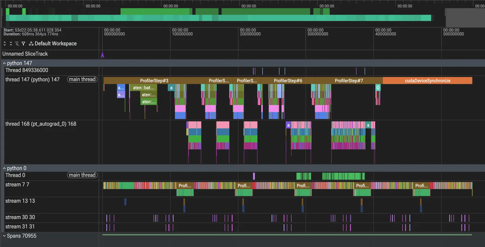
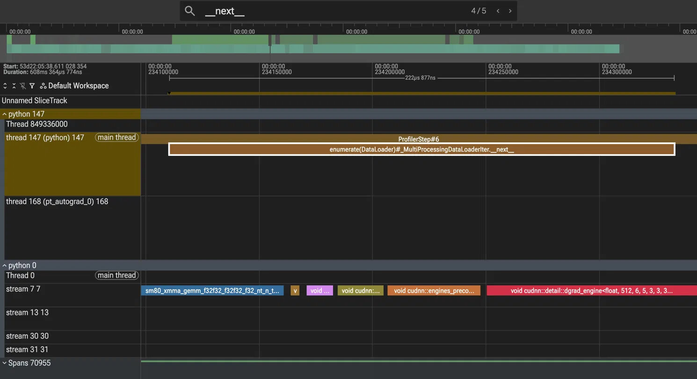
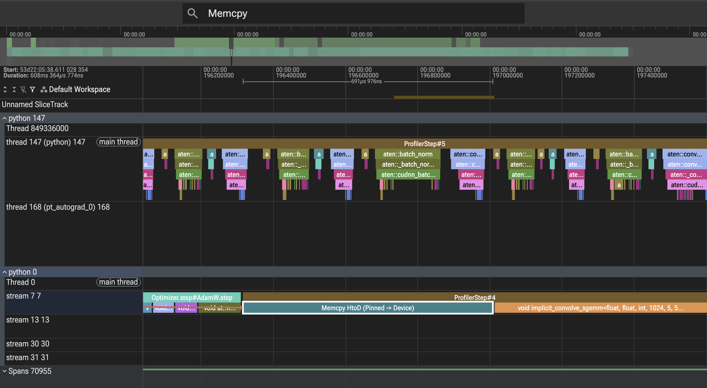
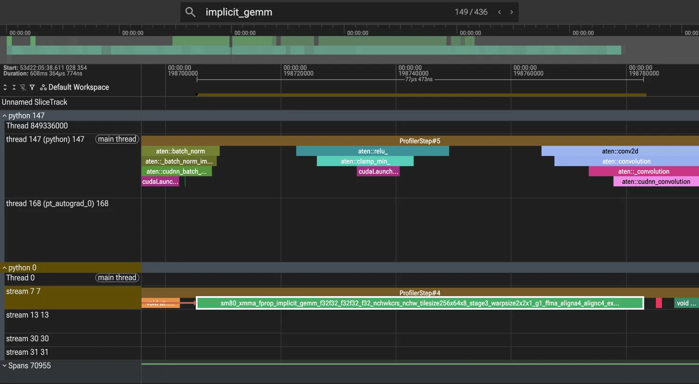
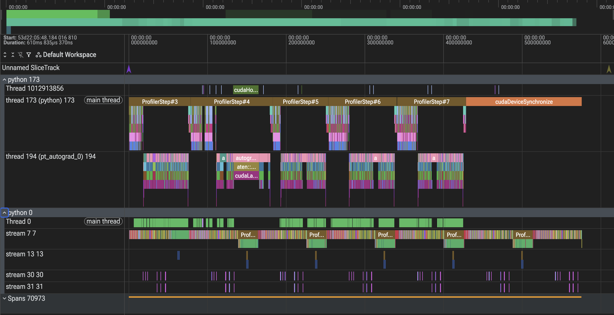
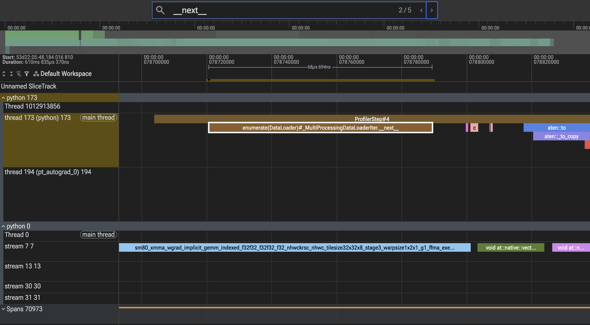

# TP6 — Accélérer un ResNet (CSC8607)

> Mesures réalisées le 24/11/2026 sur le cluster arcadia : H100 NVL entier (exercices 0 à 3 et 5) et deux nœuds L4 (exercice 4). Captures Perfetto dans `/images/`.

## Exercice 0 — Mise en place

**Sortie de `check_env.py`** (job 56721)

```
Job 56721 sur arcadia-slurm-node-3 ; GPU : 0 ; CPU : 4
GPU 0: NVIDIA H100 NVL (UUID: GPU-c8a4c7b7-5b45-2033-9a40-92b4cf03cf33)
Machine        : arcadia-slurm-node-3
Python         : 3.10.21
torch          : 2.14.1+cu130 (CUDA 13.0)
torchvision    : 0.29.1+cu130
torchao        : 0.18.0
CPU alloués    : 4  (x86_64)
Drapeaux CPU   : avx512f, avx512_vnni, avx512_bf16
gcc            : /usr/bin/gcc
GPU            : NVIDIA H100 NVL
Mémoire GPU    : 95321 Mio au total, 94795 Mio libres
bf16 supporté  : True
Données raw    : /mnt/ssd/imagenet/2012 -> (12894, 500) images (train, val)
Données small  : /tmp/ibelkhir/tp6/imagenet10_256 -> (12894, 500) images (train, val)
```

> **Remarque importante.** Le job a obtenu un **H100 NVL entier** (95 321 Mio ≈ 100 Go), et non une instance MIG 1g.12gb (≈ 11,5 Go, 1/7 des SM) comme prévu par le sujet. Toutes les mesures de ce rapport portent donc sur un GPU complet, environ 7 fois plus puissant et 8 fois plus doté en mémoire qu'un MIG.

Résumé : H100 NVL, 95 321 Mio, 4 CPU, drapeaux AVX-512 + VNNI + AVX512-BF16 (**pas d'AMX**), torch 2.14.1 (CUDA 13.0), torchvision 0.29.1, torchao 0.18.0.

**4 CPU pour alimenter le GPU : conséquence ?**
Le processus principal occupe un cœur (boucle Python, lancement des noyaux), il reste donc au plus 3 workers pour lire et décoder les JPEG. Le décodage d'un JPEG ImageNet coûte plusieurs millisecondes de CPU. Dès que le GPU ira vite (bf16, compile), le chargement deviendra probablement le maillon le plus lent (profil « limité par les données »). C'est d'autant plus vrai ici qu'on dispose d'un H100 entier, et non d'un septième, pour les mêmes 4 CPU.

## Exercice 1 — Mesure de référence

| tag | débit (img/s) | min–max | pic mémoire (Go) | époque (s) |
|---|---|---|---|---|
| ref-synth | 730,8 | 728,2–733,7 | 5,95 | — |
| ref-raw | 731,6 | 731,1–732,2 | 5,95 | 21,0 |

(fp32 « pur », TF32 désactivé, batch 64, AdamW.) La dispersion est inférieure à 1 % : la mesure est stable.

**Estimation du pic mémoire (ref-synth)**

| Poste | Calcul | Taille |
|---|---|---|
| Poids | 23,5 M × 4 o | 94 Mo |
| Gradients | 23,5 M × 4 o | 94 Mo |
| États d'AdamW (m, v) | 23,5 M × 8 o | 188 Mo |
| **Statique** | 23,5 M × 16 o | **0,38 Go** |
| Activations | 64 × 84 Mo | 5,38 Go |
| Batch d'entrée | 64 × 3 × 224² × 4 o | 0,04 Go |
| **Total estimé** | | **≈ 5,79 Go** |

Mesure : **5,95 Go**, soit seulement **+2,8 %** par rapport à l'estimation. Les activations représentent ≈ 90 % du total, comme l'annonce le cours (« CNN : mémoire dominée par les activations »). Les ≈ 0,16 Go supplémentaires viennent de ce que le modèle ne compte pas :
- les tenseurs temporaires du pas d'AdamW (l'implémentation *foreach* crée des intermédiaires de la taille des paramètres, ≈ 94 Mo chacun) ;
- les espaces de travail de cuDNN pour les convolutions ;
- les gradients des activations qui coexistent avec les activations encore gardées pendant le backward ;
- l'arrondi des blocs par l'allocateur.

L'estimation « une sortie par couche × 4 o » donne donc le bon ordre de grandeur et le bon poste dominant. `max_memory_allocated` ne compte ni le cache de l'allocateur ni le contexte CUDA ; `nvidia-smi` afficherait davantage.

**ref-async**
Retour de l'appel : **22,8 ms** ; fin réelle du pas : **86,4 ms** (cohérent avec ref-synth : 64 / 730,8 = 87,6 ms).
Le CPU rend la main dès que les noyaux sont *mis en file*, soit après 26 % seulement du temps réel. Un chronométrage sans `torch.cuda.synchronize()` donnerait 64 / 0,0228 ≈ 2 800 img/s au lieu de ≈ 740, un débit **surestimé d'un facteur 3,8**. Le temps du GPU serait reporté sur la prochaine opération bloquante (`.item()`, copie vers le CPU…).
Ces 22,8 ms mesurent aussi le coût de *lancement* d'un pas (des milliers de noyaux pour le forward, le backward et AdamW). Un pas ne pourra jamais descendre sous ce temps CPU sans fusion ni CUDA Graphs. Au-delà de ≈ 2 800 img/s, l'entraînement serait limité par le lancement : à surveiller à l'exercice 3.

**Batch maximal fp32 : 1 128** (`results_maxbatch.csv`), contre « de l'ordre de 120 » dans le cours.
L'écart vient du matériel : le cours raisonne sur un MIG de 11,5 Go, alors que nous avons un H100 entier (≈ 99,4 Go libres). Avec la méthode du cours : (99,4 − 0,38) / 0,084 ≈ 1 180 images. La mesure (1 128) est 4 % en dessous, ce qui s'explique par la part mesurée réelle par image (≈ 2,8 % de plus que 84 Mo, cf. ci-dessus), les espaces de travail de cuDNN qui grossissent avec le batch, la fragmentation de l'allocateur et le pas de 8 de la dichotomie. Ramené à un MIG (≈ 11 Go utilisables), le même calcul donne ≈ 126, soit environ 120 : la prévision du cours est cohérente. La relation est linéaire en mémoire disponible, au terme statique près.
Les avertissements `CUDACachingAllocator ... OOM` du journal sont les essais volontairement trop gros de la recherche.

**ref-raw vs ref-synth : 731,6 contre 730,8 img/s, identiques** (à la dispersion près).
En fp32 pur, le GPU met ≈ 87 ms par pas : c'est lui le maillon lent, et 3 workers suffisent à suivre. On en déduit déjà que les 3 workers décodent **au moins** 731 img/s, soit ≥ 244 img/s par worker (t_d ≤ 4,1 ms par image). Toute accélération du calcul (TF32, bf16, compile) rapprochera le GPU de ce plafond, qui deviendra le goulot.
L'époque complète prend 21,0 s, alors que 201 pas × 64 / 731,6 = 17,6 s en régime établi. Les ≈ 3,4 s supplémentaires correspondent à l'amorçage du pipeline : création d'un nouvel itérateur du DataLoader, files de préchargement à remplir au début de l'époque, GPU qui attend les premiers batchs. Le débit sur l'époque (≈ 613 img/s) est donc inférieur au débit en régime établi.

## Exercice 2 — Chargement des données et profilage

| tag | débit (img/s) | min–max | % de ref-synth |
|---|---|---|---|
| raw-w0 | 218,6 | 202,6–234,7 | 30 % |
| raw-w1 | 226,4 | 223,0–229,8 | 31 % |
| raw-w2 | 581,6 | 454,9–708,3 | 80 % |
| raw-w3 | 720,4 | 719,1–721,6 | 99 % |
| raw-w3-nopin | 649,1 | 649,1 | 89 % |
| small-w0 | 263,5 | 263,5–263,6 | 36 % |
| small-w3 | 716,8 | 716,0–717,7 | 98 % |

(fp32, batch 64 ; référence ref-synth = 730,8 img/s.)

**Évolution avec le nombre de workers.**
- Avec 0 ou 1 worker, le débit plafonne à ≈ 220 img/s, soit 30 % du GPU : c'est le chargement qui limite.
- Le passage de 0 à 1 worker gagne peu, car un worker seul décode à peine plus vite que le processus principal (un worker est limité à un thread PyTorch pour `ToTensor`/`Normalize`, alors que le processus principal en utilise 4).
- À 2 workers, le débit (≈ 580 img/s) reste sous le GPU et la mesure est très dispersée (455 à 708 img/s) : le chargement limite encore et varie avec la charge du CPU partagé.
- À 3 workers, on atteint 720 img/s, soit 99 % du débit synthétique, avec une dispersion < 0,5 % : c'est le GPU qui limite désormais.

On ne peut pas dépasser 3 workers utiles avec `--cpus-per-task=4`, car le processus principal occupe un cœur (boucle d'entraînement, lancement des noyaux, thread de `pin_memory`). Un 4ᵉ worker se partagerait les mêmes 4 cœurs : changements de contexte, et le processus principal serait ralenti dans le lancement des noyaux. Au-delà du nombre de cœurs réservés, ajouter des workers ralentit (cours).

**Effet de pin_memory : −10 %** (720,4 → 649,1 img/s, soit 64/649,1 − 64/720,4 ≈ +9,8 ms par pas).
`pin_memory=True` place le batch en mémoire hôte non paginée (page-locked). Le GPU peut alors le lire directement par DMA, et la copie lancée avec `non_blocking=True` est asynchrone : elle recouvre le calcul. La trace le confirme : la copie d'un batch (38,5 Mo) dure ≈ 0,69 ms, soit ≈ 56 Go/s (PCIe Gen5). Sans mémoire épinglée, la copie passe par un tampon intermédiaire et devient synchrone : le processus principal est bloqué ≈ 10 ms à chaque pas (≈ 4 Go/s effectifs), ce qui retarde le lancement des noyaux suivants.

**Pourquoi small se charge plus vite (263,5 contre 218,6 img/s à 0 worker).**
Les JPEG d'origine d'ImageNet font en moyenne ≈ 400 × 350 px, et souvent bien plus ; la copie a 256 px de côté court, soit ≈ 2 fois moins de pixels à décoder et des fichiers plus petits à lire. Le gain par image n'est que de 25 %, car une partie du coût ne dépend pas de la taille d'origine (redimensionnement vers 224, `ToTensor`, `Normalize`).
Le modèle voit des crops 224 × 224 issus de la même distribution : `RandomResizedCrop` prend une fraction *relative* de l'image (8 à 100 % de sa surface) puis la ramène à 224. Seule différence : un redimensionnement de plus (léger lissage). Ce ne sont pas exactement les mêmes pixels, mais c'est la même tâche.

**Temps de décodage** : 1/D_w0 ≈ t_d + 1/D_synth, avec 1/D_synth = 1/730,8 = 1,37 ms.

| | D_w0 (img/s) | t_d = 1/D_w0 − 1/D_synth | 1 worker ≈ 1/t_d | 3 workers ≈ 3/t_d |
|---|---|---|---|---|
| raw | 218,6 | 4,57 − 1,37 = **3,21 ms** | ≈ 310 img/s | ≈ 935 img/s |
| small | 263,5 | 3,80 − 1,37 = **2,43 ms** | ≈ 410 img/s | ≈ 1 235 img/s |

Ces valeurs sont des bornes hautes. raw-w1 ne mesure que 226 img/s au lieu de 310, car un worker est plus lent que le processus principal (1 thread) et le CPU est partagé. La capacité réelle d'un worker en raw est donc de ≈ 230 à 310 img/s.
**3 workers ne suffiront plus dès que le GPU dépassera ≈ 700 à 935 img/s en raw et ≈ 1 200 img/s en small.** Le fp32 pur (731 img/s) est juste à la limite en raw. TF32, bf16 et compile la dépasseront largement sur un H100 entier : l'entraînement deviendra limité par les données (vérifié à l'exercice 3).

**Traces Perfetto**

*raw-w3 : vue d'ensemble des 5 itérations (fil principal CPU et flux CUDA « stream 7 »)*


*raw-w3 : attente d'un batch côté CPU (`_MultiProcessingDataLoaderIter.__next__`, 222 µs), le flux CUDA continue de calculer en dessous*


*raw-w3 : jonction entre deux itérations sur le GPU : fin d'`AdamW.step`, copie `Memcpy HtoD` (38,5 Mo, 692 µs), puis première convolution de l'itération suivante, sans aucun trou*


*raw-w3 : noyau de convolution `sm80_xmma_fprop_implicit_gemm_f32f32_…_nchwkcrs_nchw_…_ffma…` (77 µs) : fp32 sur cœurs CUDA (FFMA), disposition NCHW*


*small-w3 : vue d'ensemble (stream 7 plein, `cudaDeviceSynchronize` final) et attente d'un batch (`__next__`, 69 µs, pendant qu'un noyau `wgrad_implicit_gemm…ffma` tourne sur le GPU)*



Analyse des 5 itérations enregistrées (aussi vérifiée en lisant le JSON des traces) :

| trace | durée moyenne d'un pas (GPU) | GPU occupé | trous > 2 ms sur le flux CUDA | attente `DataLoader.__next__` | copie HtoD par batch |
|---|---|---|---|---|---|
| raw-w3 | ≈ 82 ms | 99 % | aucun | ≈ 0,1 ms | 0,69 ms |
| small-w3 | ≈ 86 ms | 99 % | aucun | ≈ 0,1 ms | 0,70 ms |

Les deux traces relèvent du profil **limité par le calcul** :
- la ligne du flux CUDA est continue, sans trou entre les itérations ;
- l'événement `enumerate(DataLoader)#_MultiProcessingDataLoaderIter.__next__` ne dure que ≈ 0,1 ms : le batch suivant est toujours prêt, préchargé par les workers ;
- le tableau du profiler est dominé par les convolutions : `convolution_backward` représente 44 à 46 % du temps GPU, avec les noyaux cuDNN `wgrad_alg0_engine` et `dgrad_engine` pour le backward et `sm80_xmma_fprop_implicit_gemm_f32f32` pour le forward. Ce sont des noyaux **fp32 (cœurs CUDA, pas Tensor Cores)**, ce qui explique la lenteur relative du calcul ;
- les captures confirment ces chiffres :
  - **A** : à la fin de la trace, le fil principal reste bloqué ≈ 130 ms dans `cudaDeviceSynchronize`, c'est-à-dire qu'il attend le GPU ;
  - **C** et **D** : quand le GPU exécute `ProfilerStep#4`, le CPU lance déjà les opérations de `ProfilerStep#5`, il a donc une itération d'avance ;
  - **C** : la copie s'exécute sur le même flux (stream 7) que le calcul, entre la fin d'`AdamW.step` et la première convolution. Le GPU ne calcule pas pendant ces 0,69 ms, mais cela représente moins de 1 % d'un pas. Ce que `pin_memory` + `non_blocking` font recouvrir, c'est le travail du **CPU** : il n'est pas bloqué par la copie et continue à lancer les noyaux. Sans mémoire épinglée, il est bloqué ≈ 10 ms par pas (−10 % de débit) ;
  - **D** : le nom du noyau de convolution contient `ffma` (multiplication-addition fp32 sur les cœurs CUDA, sans Tensor Cores) et `nchw` (disposition mémoire non optimale pour les Tensor Cores). Ce sont précisément les deux points que traitent bf16/TF32 et channels_last à l'exercice 3 ;
- ce n'est pas non plus un profil « limité par le lancement » : les noyaux durent des centaines de µs, pas quelques µs, et le CPU prend de l'avance sur le GPU (la durée des `ProfilerStep` côté CPU varie de 40 à 150 ms, car le CPU attend que la file du GPU se vide).

En fp32 pur, 3 workers suffisent donc pour raw comme pour small : le goulot est le calcul fp32, et pré-redimensionner les images n'apporte rien *à ce stade*.

**Meilleure configuration de chargement** : raw-w3 = 720,4 img/s, soit **98,6 % de ref-synth** (small-w3 : 98,1 %). L'écart de 1 à 2 % est du même ordre que le bruit entre deux mesures (ref-raw a donné 731,6 img/s) : le chargement est entièrement caché derrière le calcul.

## Exercice 3 — bf16, channels_last, torch.compile

| configuration | données | workers | débit médian (img/s) | min–max | pic mém. (Go) | compilation (s) |
|---|---|---|---|---|---|---|
| fp32 | synth | — | 729,6 | 724,6–732,6 | 5,95 | — |
| tf32 | synth | — | 1 652,1 | 1 630,0–1 689,3 | 5,93 | — |
| bf16 | synth | — | 1 999,4 | 1 998,7–2 004,2 | 3,29 | — |
| bf16-cl | synth | — | 2 594,5 | 2 392,9–2 657,7 | 3,29 | — |
| bf16-cl-compile | synth | — | 3 555,1 | 3 533,1–3 555,2 | 3,07 | 43,9 |
| bf16-cl | raw | 1 | 267,3 | 210,7–318,7 | 3,29 | — |
| bf16-cl-compile | raw | 1 | 313,7 | 225,0–334,0 | 3,07 | 4,3 |
| bf16-cl | raw | 3 | 3 299,5 ⚠ | 1 986,4–3 307,4 | 3,29 | — |
| bf16-cl-compile | raw | 3 | 3 925,4 ⚠ | 1 241,3–4 048,7 | 3,07 | 3,9 |
| bf16-cl | small | 1 | 372,1 | 334,4–403,8 | 3,29 | — |
| bf16-cl-compile | small | 1 | 487,1 | 435,6–488,5 | 3,07 | 4,8 |
| bf16-cl | small | 3 | 1 466,7 ⚠ | 1 397,4–2 099,8 | 3,29 | — |
| bf16-cl-compile | small | 3 | 4 191,4 ⚠ | 2 295,4–4 238,8 | 3,07 | 3,6 |

⚠ = médiane non représentative du débit réel (voir plus bas).

**Reproductibilité.** fp32-synthetic = 729,6 img/s contre 730,8 pour ref-synth (exercice 1), soit un écart de **−0,16 %**. En données synthétiques (calcul seul), la mesure est reproductible à mieux que 1 % : tout écart de quelques pourcents entre deux configurations est significatif. Avec de vraies images, le CPU est partagé et la dispersion d'une même mesure atteint ×1,5 à ×3 (min–max ci-dessus) : là, seuls de gros écarts sont interprétables.

**Gain de chaque levier (synthétique, batch 64)**

| Étape | Débit | Temps/pas | Facteur | Explication (cours) |
|---|---|---|---|---|
| fp32 | 729,6 | 87,7 ms | — | Convolutions sur cœurs CUDA (noyaux `…_ffma…`, cf. trace), pic 60 TFLOP/s |
| → TF32 | 1 652,1 | 38,7 ms | **×2,26** | Convolutions et matmul passent sur les **Tensor Cores** (≈ 418 TFLOP/s). Gain bien inférieur au rapport des pics (×7) : les opérations élément par élément (BN, ReLU, addition résiduelle) et AdamW sont **limitées par la mémoire** (roofline) et ne profitent pas des Tensor Cores ; les données restent en fp32 (même mémoire : 5,93 Go). |
| → bf16 | 1 999,4 | 32,0 ms | **×1,21** | Tensor Cores 16 bits (pic ×2 par rapport à TF32) et **2 octets par valeur** : trafic mémoire ÷ 2, activations ÷ 2 (pic 5,95 → 3,29 Go). Gain modeste, car cuDNN en bf16 préfère la disposition NHWC : en NCHW, il ajoute des noyaux de transposition autour de chaque convolution, et autocast ajoute des noyaux de conversion fp32 → bf16. |
| → channels_last | 2 594,5 | 24,7 ms | **×1,30** | NHWC est la disposition native des Tensor Cores pour les convolutions : on supprime les transpositions NCHW ↔ NHWC, donc moins de trafic mémoire et moins de noyaux. |
| → compile | 3 555,1 | 18,0 ms | **×1,37** | TorchInductor **fusionne** les opérations élément par élément (BN + ReLU + addition) en noyaux Triton : 3 lectures et 3 écritures deviennent 1 et 1, et il y a beaucoup moins de noyaux à lancer. Le pic mémoire baisse aussi (3,29 → 3,07 Go) : les intermédiaires fusionnés ne sont plus stockés. |
| **Total** | | | **×4,87** | |

Lien avec l'exercice 1 : lancer un pas en eager coûte ≈ 23 ms de CPU (ref-async). Avec bf16-cl, le pas GPU (24,7 ms) tombe au niveau de ce coût de lancement : on passe d'un profil « limité par le calcul » à un profil **« limité par le lancement »**, celui que `torch.compile` corrige (moins de noyaux, donc moins d'appels à `cudaLaunchKernel`). D'où le gain de ×1,37 de compile, plus fort que celui de bf16.

**Synthétique vs vraies données**

*Avec 1 worker* : la prévision de l'exercice 2 (plafond ≈ 1/t_d, soit ≈ 230 à 310 img/s en raw et ≈ 410 en small) se vérifie : 267 à 314 img/s en raw et 372 à 487 en small, soit **≈ 10 % du débit synthétique**. Le goulot est le **chargement** : le GPU attend ≈ 90 % du temps. compile semble gagner 17 à 31 %, mais l'écart est du même ordre que la dispersion (raw-w1 : 211 à 319 img/s). L'effet réel, s'il existe, viendrait du CPU : le processus principal passe moins de temps à lancer des noyaux, ce qui laisse plus de temps CPU (et de GIL) au thread de `pin_memory`. compile n'accélère pas le maillon limitant.

*Avec 3 workers*, les médianes sont **physiquement impossibles** : bf16-cl-compile-raw-w3 = 3 925 img/s et bf16-cl-compile-small-w3 = 4 191 img/s dépassent à la fois le plafond de 3 workers (3/t_d ≈ 935 img/s en raw, ≈ 1 235 en small) et le débit synthétique (3 555 img/s). C'est un **artefact de la mesure** : `benchmark` prend la *médiane des durées par pas*. Or chaque worker prépare un batch entier (64 images, ≈ 200 à 280 ms en raw) et les 3 workers livrent leurs batchs presque en même temps. Un pas sur trois attend longtemps, les deux suivants trouvent leur batch prêt et ne durent que le temps du calcul. La médiane retient ces pas courts et mesure donc la vitesse du GPU, pas celle du pipeline. Le débit réel est le nombre total d'images divisé par la durée totale, c'est-à-dire un temps d'époque (vérifié ci-dessous). Ces pas « courts » sont même plus rapides qu'en synthétique, probablement parce que le GPU, souvent au repos, garde des fréquences d'horloge plus élevées (moins de limitation thermique et de puissance).
Le min–max le confirme : raw-w3-compile varie de 1 241 à 4 049 img/s selon les répétitions.

*Vérification (`ex3b.sh`, job 56729)* : même configuration, mais débit calculé sur **une époque complète** (201 pas × 64 images / durée).

| configuration | médiane par pas (img/s) | époque (s) | **débit réel (img/s)** | % du synthétique |
|---|---|---|---|---|
| bf16-cl, raw, 3 workers | 2 809 | 23,1 | **557** | 21 % |
| bf16-cl-compile, raw, 3 workers | 2 220 | 23,0 | **559** | 16 % |
| bf16-cl, small, 3 workers | 2 238 | 9,4 | **1 369** | 53 % |
| bf16-cl-compile, small, 3 workers | 1 619 | 13,9 | **925** | 26 % |

Le débit réel est 3 à 5 fois plus faible que la médiane par pas, ce qui confirme l'artefact. Il se situe bien au niveau du plafond prévu à l'exercice 2 :
- **raw** : ≈ 560 img/s, soit ≈ 190 img/s par worker (t_d ≈ 5 ms par image dans un worker mono-thread). Le fp32 de l'exercice 1 (époque 21,0 s, 613 img/s) allait déjà aussi vite : en raw, bf16, channels_last et compile n'apportent **rien**.
- **small** : ≈ 1 370 img/s, proche de 3/t_d ≈ 1 235 img/s prévu. Le pré-redimensionnement multiplie le débit réel par ≈ 2,5.
- **compile** : aucun gain en raw (23,0 contre 23,1 s). En small, il est même plus lent sur cette mesure unique (13,9 contre 9,4 s), ce qui relève du bruit du CPU partagé, ou du coût CPU de compile au démarrage de l'époque. Dans tous les cas, compile est inutile quand le chargement limite.
- La compilation a de nouveau pris 39,7 s dans ce job, puis 4,9 s : le cache d'Inductor survit entre deux processus d'un même job, mais **pas d'un job à l'autre**. Le répertoire `/tmp` de SLURM est vraisemblablement propre à chaque job ; seul le cache Triton du répertoire personnel est conservé, d'où 39,7 s au lieu de 43,9 s.

*Où est le goulot ?* Le chargement dans les quatre configurations réelles, même à 3 workers : leur plafond (≈ 900 à 1 200 img/s) est 3 à 4 fois sous le débit du GPU en bf16-cl-compile. **compile ne rapporte rien quand le chargement limite** : on accélère un maillon qui n'est pas le plus lent.

*Dispersion à 1 worker* (raw : 211 à 319 img/s, soit ±20 %) : le débit dépend d'un seul cœur CPU, partagé avec les autres jobs du nœud. Il fluctue avec leur charge, alors que la mesure synthétique est stable à < 1 %.
*Loi d'Amdahl* : en raw-w1, un pas dure ≈ 64/267 = 240 ms, dont ≈ 25 ms de calcul GPU (bf16-cl), donc p ≈ 0,10. Même un calcul infiniment rapide ne donnerait que S ≤ 1/(1 − p) ≈ ×1,11. Avec le ×1,37 de compile sur le calcul : S = 1/(0,90 + 0,10/1,37) ≈ ×1,03. Accélérer le GPU est inutile tant que le chargement n'est pas parallélisé.

**Workers nécessaires pour un H100 entier.** Le sujet raisonne depuis un MIG (1/7 de H100), alors que *nos mesures sont déjà sur un H100 entier* : il faut y fournir 3 555 img/s (bf16-cl-compile). Un worker fournit ≈ 190 à 310 img/s en raw et ≈ 370 à 490 en small, d'où :
- raw : 3 555 / 190 à 310 ≈ **12 à 19 workers** (≈ 190 img/s par worker d'après le temps d'époque de `ex3b.sh`) ;
- small : 3 555 / 370 à 490 ≈ **7 à 10 workers**.

Sur un MIG (≈ 3 555 / 7 ≈ 510 img/s), il en faudrait ≈ 2 à 3, ce qui correspond exactement aux 4 CPU par job prévus par le sujet. Les 30 cœurs d'un nœud arcadia suffiraient pour **un** H100 entier alimenté en small (≈ 10 workers + le processus principal), juste pour raw. En revanche, ils ne suffiraient pas pour les 7 MIG d'un même H100 (7 × 3 workers + 7 processus principaux = 28 cœurs, sans marge), ni pour plusieurs GPU entiers. Il faut alors des images pré-redimensionnées, voire un décodage sur GPU (DALI, `torchvision.io.decode_jpeg(device="cuda")`).

**Compilation cinq fois** : 43,9 s, puis 4,3 / 3,9 / 4,8 / 3,6 s. La première compilation est faite « à froid » ; les suivantes réutilisent les **caches d'Inductor** (graphe FX compilé et noyaux Triton, stockés sur le disque local du nœud dans `/tmp/torchinductor_$USER`), car le modèle, les formes et les options sont identiques : il ne reste que le traçage par Dynamo et le chargement des noyaux.
Amortissement, en régime limité par le calcul : gain par pas = 24,67 − 18,00 = 6,67 ms.
- Sans cache : 43,9 / 0,00667 ≈ **6 600 pas** (≈ 33 époques).
- Avec cache : 3,6 à 4,8 / 0,00667 ≈ **540 à 720 pas**.

Pour 2 × 201 = 402 pas, ce n'est **pas rentable**, même avec le cache, et encore moins en pratique : avec de vraies images le chargement limite, le gain par pas est ≈ 0 et la compilation ne s'amortit jamais. compile ne devient intéressant que pour un long entraînement *et* un pipeline de données qui suit.

**Batch maximal bf16 : 2 200**, contre 1 128 en fp32, soit un rapport de **1,95**.
Le cours prédit ≈ 2 : les activations passent de 4 à 2 octets, tandis que l'état statique (0,38 Go) reste en fp32. Les mesures à batch 64 le confirment : ≈ 87 Mo par image en fp32 ((5,95 − 0,38)/64) contre ≈ 45 Mo en bf16 ((3,29 − 0,43)/64), soit un rapport de 0,51. La prédiction (99,4 − 0,43)/0,0447 ≈ 2 214 est vérifiée à 0,6 % près. Le rapport reste légèrement sous 2 car :
- la part fixe ne diminue pas (poids, gradients et états d'Adam en fp32, plus 0,05 Go de copies bf16 des poids pour autocast) ;
- une partie des activations reste en fp32 : batch d'entrée, statistiques des BatchNorm, logits et perte ;
- les espaces de travail de cuDNN grossissent avec le batch.

**train.py** (job 56728 ; `--precision bf16 --channels-last --compile --data small --workers 3`, ResNet-50 pré-entraîné sur ImageNet, AdamW, lr 3·10⁻⁴, cosinus)

| époque | temps (s) | img/s | top-1 val |
|---|---|---|---|
| 0 | 45,5 | 283 | 0,990 |
| 1 | 10,5 | 1 226 | **0,992** |

**Pourquoi l'époque 0 est plus lente (+35 s).** Elle contient :
- la **compilation** de `torch.compile` : ≈ 40 s à froid, puisque le cache ne survit pas d'un job à l'autre (cf. `ex3b.sh`, 39,7 s) ;
- le démarrage des 3 workers et le remplissage des files de préchargement ;
- l'autoréglage de cuDNN et l'allocation initiale de la mémoire (dont les états d'AdamW, créés au premier `opt.step()`).

L'évaluation n'ajoute pas de recompilation, car `evaluate` utilise le modèle eager (`model`), pas `fwd`.

**Époque 1 : 10,5 s, soit 1 226 img/s.** C'est cohérent avec la mesure d'époque de bf16-cl-small-w3 (9,4 s, 1 369 img/s) : l'entraînement est **limité par le chargement** des images, pas par le GPU (≈ 35 % de son débit synthétique en bf16-cl-compile).

**Accélération totale** par rapport à ref-raw (exercice 1 : fp32, raw, 3 workers, époque de 21,0 s) : 21,0 / 10,5 = **×2,0**.
- Ce gain vient presque entièrement du **chargement** (images pré-redimensionnées), et non des leviers GPU : en raw, bf16-cl met 23,1 s par époque, soit autant qu'en fp32.
- Sur 2 époques, compile **coûte** ≈ 35 s pour un gain par pas nul : 56 s au total, contre ≈ 20 s attendues sans compile (2 × 9,4 s + ≈ 1 s d'amorçage). Pour un entraînement aussi court, la meilleure configuration réelle est **bf16 + channels_last sans compile**, sur small.
- Le potentiel mesuré en calcul seul (×4,87) reste inaccessible tant que 3 workers ne fournissent que ≈ 1 400 img/s.

Le top-1 de 99,2 % dès 2 époques s'explique par le transfert : les poids ImageNet ont déjà appris ces 10 classes, qui sont des classes d'ImageNet ; seule la dernière couche part de zéro.

## Exercice 4 — DDP sur deux L4 (job 56730)

Nœuds : `starfighter-slurm-node-02-1` (rang 0, rendez-vous) et `starfighter-slurm-node-03-1` (rang 1), une NVIDIA L4 entière chacun.

**Communication** (`logs/nccl-56730.log`) :
- `NET/IB : No device found` puis `Using network Socket` / `via NET/Socket/0` : pas d'InfiniBand, NCCL passe par des **sockets TCP** sur l'interface Ethernet `ens18` (10.91.152.162 ↔ .163), sans GPUDirect (`GDR 0`), avec 2 canaux en anneau.
- All-reduce de 102 Mo : **877,5 ms**, débit algorithmique **0,12 Go/s**, débit par lien **0,12 Go/s**. Pour N = 2, busbw = algbw × 2(N − 1)/N = algbw.
- En Gbit/s : 102,2 Mo / 0,8775 s = 0,116 Go/s × 8 ≈ **0,93 Gbit/s**, soit un lien **Ethernet 1 Gbit/s** (`ens18` est le nom typique d'une carte virtuelle de machine virtuelle). C'est environ 1 000 fois moins que NVLink, et environ 25 fois moins que la copie PCIe hôte → GPU mesurée à l'exercice 2 (56 Go/s).

Le message `TCPStore … recvVector failed` à la fin de chaque mesure multi-nœuds vient de l'arrêt du rendez-vous après la sortie du premier nœud. Il est sans conséquence : les lignes de résultats sont présentes.

| tag | processus | accumulation | batch effectif | pas (ms) | débit global (img/s) | S = D2/D1 | E = S/2 |
|---|---|---|---|---|---|---|---|
| A. check_dist (all-reduce 102 Mo) | 2 | — | — | 877,5 | — | — | — |
| B. l4-x1 | 1 | 1 | 64 | 136,8 | 468,0 | 1 (réf.) | — |
| C. l4-x2 | 2 | 1 | 128 | 865,9 | 147,8 | **0,32** | 0,16 |
| D. l4-x2-bf16hook | 2 | 1 | 128 | 462,8 | 276,6 | **0,59** | 0,30 |
| E. l4-x1-accum8 | 1 | 8 | 512 | 1 037,3 | 493,6 | 1 (réf.) | — |
| F. l4-x2-accum8-bf16hook | 2 | 8 | 1 024 | 1 361,3 | 752,2 | **1,52** | 0,76 |

(bf16, channels_last, données synthétiques, 64 images par processus et par micro-batch.) Sans accumulation, passer à deux nœuds **divise le débit par 3** : le DDP est ici contre-productif.

**Estimation de la communication**
- t_c pour 94 Mo de gradients : 877,5 × 94/102,2 ≈ **807 ms**, soit 6 fois le temps de calcul d'un pas (t1 = 136,8 ms).
- Aucun recouvrement : t1 + t_c = 944 ms. Recouvrement parfait : max(t1, t_c) = 807 ms. Mesuré : **T2 = 865,9 ms**, entre les deux.
- Durée cachée : t_rec = t1 + t_c − T2 = 944 − 866 ≈ **78 ms**. DDP lance l'all-reduce de chaque paquet de 25 Mo dès qu'il est prêt pendant le backward. Le recouvrement est limité à la durée du backward (≈ 2/3 de t1, soit ≈ 90 ms) : on en cache presque tout, mais il reste ≈ 730 ms de communication à découvert.

**Effet de `--bf16-hook`** : 865,9 → 462,8 ms par pas (×1,87), S passe de 0,32 à 0,59.
- Le hook convertit les gradients en bf16 avant l'all-reduce : **2 fois moins d'octets sur le réseau**, donc t_c ≈ 404 ms.
- Le modèle le prévoit exactement : t1 + t_c/2 − t_rec = 136,8 + 403,5 − 78 = **462,4 ms** (mesuré : 462,8). Le gain vient entièrement du volume transmis.
- Risque : la somme des gradients se fait avec 8 bits de mantisse (erreur relative ≈ 2⁻⁸ ≈ 0,4 %). Les petites composantes du gradient sont arrondies, voire absorbées par les grandes, ce qui peut ralentir ou dégrader la convergence. Avec de gros gradients bien conditionnés, c'est généralement acceptable ; il faut le vérifier sur la courbe de validation.

**Pourquoi pas Amdahl, et prédiction de F**
Amdahl suppose un travail fixe découpé entre N processeurs, dont une fraction (1 − p) est séquentielle *et déjà présente sur un GPU* ; S ne peut alors pas descendre sous 1. Ici, au contraire :
1. chaque GPU garde son batch de 64 (passage à l'échelle faible : on traite 2 fois plus d'images par pas) ;
2. le surcoût est un travail **nouveau**, absent sur un GPU, qui ne se parallélise pas : la communication ;
3. ce travail est partiellement recouvert par le calcul.

D'où S = 0,32 < 1, impossible dans le modèle d'Amdahl.
Modèle : T2 ≈ k·t1 + t_c − t_rec, avec k·t1 = pas de l4-x1-accum8 = 1 037,3 ms, t_c = 403,5 ms (bf16) et t_rec = 78 ms. **Prédiction : 1 037,3 + 403,5 − 78 ≈ 1 363 ms. Mesuré : 1 361,3 ms** (écart de 0,1 %). Avec `no_sync()`, seul le dernier des 8 backward communique : le coût de communication (≈ 326 ms non recouverts) est payé une fois pour 8 micro-batchs, et S monte à 1,52.

**Condition de rentabilité.** Le DDP sur 2 nœuds bat 1 GPU si 2k·t1 / (k·t1 + t_c − t_rec) > 1, c'est-à-dire si le calcul par pas d'optimiseur dépasse la communication non recouverte : **k·t1 > t_c − t_rec**.
- Avec bf16 : k·t1 > 326 ms, soit k ≥ 3 micro-batchs de 64 (t1 ≈ 130 ms par micro-batch).
- Pour S proche de 2, il faut k·t1 ≫ 326 ms.

Leviers et leur prix :
- **Accumulation de gradients** (k grand) : batch effectif ×k, donc réajuster le taux d'apprentissage. On fait aussi k fois moins de pas d'optimiseur par époque, et la BatchNorm reste calculée sur 64 images.
- **Compression des gradients** (bf16, voire plus agressive) : perte de précision des gradients, risque pour la convergence.
- **Batch par GPU plus grand** : plus de mémoire (la L4 a 24 Go) et une autre dynamique d'optimisation.
- **Réseau plus rapide** : avec 10 GbE, t_c ≈ 81 ms serait presque entièrement caché par le backward. C'est un coût matériel.

**Taux d'apprentissage** (référence η0 réglé pour B0 = 64 sur un GPU) :

| batch effectif | AdamW (racine carrée) | SGD (linéaire + warm-up) |
|---|---|---|
| 128 | η0·√2 ≈ 1,41 η0 | 2 η0 |
| 1 024 | η0·√16 = 4 η0 | 16 η0, atteint progressivement par un warm-up |

Ce sont des points de départ, à valider sur la courbe de validation. On fait aussi 8 à 16 fois moins de pas par époque : il faut comparer à nombre d'exemples vus égal.

**Graines, `set_epoch`, `no_sync`**
- *Même graine pour l'initialisation* : toutes les copies démarrent avec des poids identiques (DDP diffuse de toute façon ceux du rang 0). Comme tous les rangs appliquent ensuite le même gradient moyen, les poids restent identiques sans jamais être échangés.
- *Données différentes* (graine `seed + rank`, ou `DistributedSampler`) : chaque rang doit voir une part différente des données. Sinon les N GPU calculeraient le même gradient, et la moyenne ne vaudrait pas mieux qu'un seul GPU : on paierait la communication pour rien.
- *Sans `sampler.set_epoch(epoch)`* : le `DistributedSampler` utiliserait la même permutation à chaque époque. Mêmes batchs, dans le même ordre, sur chaque rang : moins de stochasticité, généralisation potentiellement moins bonne.
- *Sans `model.no_sync()`* : un all-reduce à chaque micro-batch au lieu d'un par pas d'optimiseur. Le résultat est mathématiquement identique, mais avec 8 communications par pas, T2 ≈ 8 × 462 ≈ 3,7 s au lieu de 1,36 s, soit S ≈ 0,56 au lieu de 1,52.

## Exercice 5 — Quantification int8 sur CPU (job 56732)

CPU : 4 threads, AVX-512, **AVX512-VNNI** et **AVX512-BF16**, pas d'AMX (cf. exercice 0). Modèle : `best.pth` de `train.py`. Batch de 1, médiane de 50 appels.

| variante | taille (Mo) | latence (ms) | 1er appel (s) | top-1 | accord_fp32 | écart logits |
|---|---|---|---|---|---|---|
| fp32-eager | 94,3 | 33,69 | 0,0 | 0,992 | 1 | 0 |
| fp32 compilé | 94,3 | 29,88 | 28,4 | 0,992 | 1 | 0 |
| bf16 compilé | 47,2 | 16,50 | 5,8 | 0,992 | 1 | 0,022 |
| int8 compilé (calib 200) | 23,9 | 10,97 | 4,2 | 0,990 | 0,998 | 0,116 |
| int8 compilé (calib 10) | 23,9 | 10,54 | 12,9 | 0,992 | 1,000 | 0,114 |

**Taille : rapport 94,3 / 23,9 = 3,95, presque 4 mais pas exactement.**
- Les poids des convolutions et de la couche linéaire passent bien de 4 à 1 octet. En revanche, une partie des tenseurs reste en fp32 ou en int32 : les **biais** (créés lors du repliement des BatchNorm dans les convolutions) et les **échelles et points zéro par canal de sortie**.
- À l'inverse, le modèle fp32 compte les paramètres et statistiques des 53 BatchNorm, qui disparaissent dans la version int8 (repliés dans les convolutions).
- Le bilan net ajoute ≈ 0,4 Mo aux 23,5 Mo de poids int8.

`weights_mb` ne compte que les tenseurs lus par le graphe (nœuds `get_attr`) : le module rendu par `convert_pt2e` conserve aussi, inutilisés, les poids fp32 d'origine. Son `state_dict` contiendrait les deux versions (≈ 94 + 24 Mo) et surestimerait la taille réelle d'un facteur 5.

**Latences (4 threads)**

| comparaison | facteur |
|---|---|
| fp32-eager → fp32 compilé | ×1,13 |
| fp32 compilé → bf16 | ×1,81 |
| **fp32 compilé → int8** | **×2,72** |
| fp32-eager → int8 | ×3,07 |

Il faut comparer l'int8 au fp32 **compilé** : la compilation apporte à elle seule ×1,13 (BN repliées dans les convolutions grâce au gel des poids `TORCHINDUCTOR_FREEZING=1`, fusion convolution + ReLU, noyaux oneDNN). Comparer à l'eager attribuerait ce gain à l'int8 (×3,07 au lieu de ×2,72).
Le gain est cohérent avec les drapeaux CPU :
- **AVX512-VNNI** (`vpdpbusd`) fait 4 produits int8 accumulés en int32 par voie de 32 bits, soit jusqu'à 4 fois plus d'opérations par instruction qu'un FMA fp32. Avec le trafic mémoire ÷ 4, on obtient le ×2,7 mesuré, sous le maximum théorique de ×4 (conversions et quantification des activations entre couches, couches peu parallèles).
- **AVX512-BF16** (`vdpbf16ps`) explique le ×1,8 du bf16.
- Le CPU n'a **pas d'AMX** (`amx_int8`, `amx_bf16`) : sur un Xeon Sapphire Rapids, les tuiles AMX donneraient un gain nettement supérieur.

**Précision.**
- L'int8 (calib 200) perd **0,2 point** de top-1 (0,992 → 0,990), soit **une seule image sur 500**, et change 1 prédiction sur 500 (accord de 99,8 %).
- Le top-1 ne suffit pas à juger : sur 500 images de 10 classes faciles, il est au plafond, et une image vaut 0,2 point, soit l'ordre de grandeur du bruit. `accord_fp32` et `ecart_logits` sont plus fins. L'écart moyen des logits est 5 fois plus grand en int8 (0,116) qu'en bf16 (0,022) : la quantification déforme réellement les sorties, mais pas assez pour changer les décisions, car les marges entre classes sont grandes.
- *calib200 vs calib10* : accord de 0,998 contre 1,000, écart de 0,116 contre 0,114, donc **pas de différence significative** (1 image d'écart). La calibration sert à fixer l'échelle s et le point zéro z de chaque **activation** à partir des valeurs observées (les poids, eux, sont quantifiés par canal à partir de leurs propres min/max, sans données). Trop peu d'images donnent une plage mal estimée : des valeurs écrêtées si la plage est trop étroite, une grille trop grossière si elle est trop large. Ici, 10 images bien réparties (une par classe) suffisent déjà, car après repliement des BN, les plages d'activation varient peu d'une image à l'autre. Sur un modèle ou des données plus hétérogènes, il faudrait quelques centaines d'images.

**1 thread vs 4 threads** (threads1, 100 images)

| variante | 1 thread | 4 threads | accélération |
|---|---|---|---|
| fp32 compilé | 72,94 ms | 29,88 ms | ×2,44 |
| int8 | 29,42 ms | 10,97 ms | ×2,68 |

L'accélération est **loin d'être proportionnelle** (×4 attendu) :
- avec un batch de 1, les dernières couches (cartes 7 × 7) offrent peu de parallélisme ;
- il faut synchroniser les threads à chaque couche ;
- les threads se partagent la bande passante mémoire et les caches ;
- le nœud est partagé avec d'autres jobs, et les 4 CPU alloués peuvent être des hyperthreads.

Conséquence pour le déploiement : pour la **latence** d'une requête isolée, 4 threads réduisent le temps de ×2,7. Pour le **débit**, 4 processus mono-thread servent 4 × 1 000/29,42 ≈ **136 img/s** en int8, contre 1 000/10,97 ≈ **91 img/s** avec un seul processus à 4 threads. Une latence n'a de sens qu'avec son matériel, son batch et son nombre de threads.

**Quantification dynamique sur un ResNet.** Elle ne quantifie que les couches `nn.Linear` (et les RNN), avec une échelle des activations calculée à la volée à chaque appel. Dans un ResNet-50, presque tout le calcul est dans les **convolutions**. La seule couche linéaire (`fc`, 2 048 × 10, soit 20 000 paramètres) représente une part négligeable des FLOP. Le gain serait quasi nul, et le calcul des échelles à la volée ajouterait même un surcoût. Pour les convolutions, il faut une quantification **statique** (échelles des activations fixées par calibration), d'où le PTQ statique de ce TP.

## Rapport final

### Tableau comparatif

| configuration | matériel | données | débit (img/s) | pic mém. (Go) | époque (s) |
|---|---|---|---|---|---|
| ref-synth (fp32, batch 64) | H100 NVL | synthétiques | 730,8 | 5,95 | — |
| ref-raw (fp32, 3 workers) | H100 NVL | raw | 731,6 (médiane) / **613** (époque) | 5,95 | 21,0 |
| tf32 | H100 NVL | synthétiques | 1 652,1 | 5,93 | — |
| bf16 + channels_last | H100 NVL | synthétiques | 2 594,5 | 3,29 | — |
| bf16 + channels_last + compile | H100 NVL | synthétiques | **3 555,1** | 3,07 | — |
| bf16-cl, 3 workers | H100 NVL | raw | 557 (époque) | 3,29 | 23,1 |
| bf16-cl, 3 workers | H100 NVL | small | **1 369** (époque) | 3,29 | 9,4 |
| train.py (bf16-cl-compile, époque 1) | H100 NVL | small | 1 226 | — | 10,5 (top-1 99,2 %) |
| DDP l4-x1 (bf16-cl) | 1 × L4 | synthétiques | 468,0 | — | — |
| DDP l4-x2 | 2 × L4, 1 GbE | synthétiques | 147,8 | — | — |
| DDP l4-x2-bf16hook | 2 × L4, 1 GbE | synthétiques | 276,6 | — | — |
| DDP l4-x1-accum8 | 1 × L4 | synthétiques | 493,6 | — | — |
| DDP l4-x2-accum8-bf16hook | 2 × L4, 1 GbE | synthétiques | 752,2 | — | — |
| Inférence fp32 compilé (4 threads, batch 1) | CPU x86 | val | 33,5 (29,88 ms) | 94,3 Mo de poids | — |
| Inférence int8 PTQ (4 threads, batch 1) | CPU x86 | val | 91,2 (10,97 ms) | 23,9 Mo de poids | — |

Les débits « époque » sont les seuls fiables quand le chargement limite (cf. exercice 3).

### Écarts à l'accélération idéale en DDP
D'après nos mesures, la quasi-totalité de l'écart vient de la **communication** :
- **Communication non recouverte** : t_c − t_rec = 807 − 78 ≈ **729 ms**, soit **84 % du pas** de l4-x2 (865,9 ms), contre 136,8 ms de calcul. Avec bf16-hook : ≈ 326 ms (70 % du pas). Avec accumulation ×8 : ≈ 326 ms sur 1 361 ms (24 %), d'où E = 0,76.
- **Chargement des données** : nul ici (données synthétiques déjà sur le GPU). Avec de vraies images, il s'ajouterait : un worker fournit ≈ 190 à 450 img/s selon raw ou small (exercices 2 et 3), et les 8 CPU d'un nœud L4 alimenteraient sans difficulté une L4 (468 img/s). Ce ne serait pas le premier goulot.
- **Synchronisation entre processus** : le débit est imposé par le rang le plus lent (réduction MAX). Le modèle T2 = k·t1 + t_c − t_rec, calibré sur l4-x2, prédit l4-x2-bf16hook à 0,1 % près (462,4 contre 462,8 ms) et l4-x2-accum8-bf16hook à 0,1 % près (1 363 contre 1 361 ms) : le déséquilibre entre rangs est donc négligeable (< 2 ms).

### Recommandation
**Pour entraîner ce ResNet-50 sur ce cluster :**
- **Un seul GPU H100** (entier ou MIG), pas de DDP multi-nœuds. Sur ce réseau Ethernet 1 Gbit/s, deux L4 sont 3 fois plus lentes qu'une seule sans accumulation. Même avec accumulation ×8 et compression bf16, elles n'atteignent que 752 img/s, avec un batch effectif de 1 024 qu'il faudrait réajuster, alors qu'un H100 seul calcule 2 594 à 3 555 img/s.
- **bf16 (autocast, sans GradScaler) + channels_last** : ×3,6 sur le calcul et ÷ 1,8 en mémoire, sans coût. On peut aussi augmenter le batch (jusqu'à ≈ 2 200).
- **Images pré-redimensionnées (small), 3 workers, `pin_memory`, `persistent_workers`** : c'est le levier qui compte en pratique (débit réel ×2,5 par rapport à raw). Le goulot reste le chargement (≈ 1 370 img/s, contre 2 600 à 3 500 côté GPU). Pour aller plus loin, il faut plus de CPU par GPU ou un décodage sur GPU (DALI, `decode_jpeg` sur cuda).
- **torch.compile seulement pour un long entraînement** et seulement si le chargement suit. Sa compilation à froid (≈ 40 s, cache perdu d'un job à l'autre) n'est pas amortie en 2 époques, et son gain par pas est nul quand les données limitent.

**Pour déployer sur CPU** : la variante **int8 PTQ statique compilée** (torchao, X86InductorQuantizer, calibration ≈ 200 images) : poids ÷ 3,95 (23,9 Mo), latence ÷ 2,7 par rapport au fp32 compilé (10,97 ms avec 4 threads), 99,8 % d'accord avec le fp32 et −0,2 point de top-1. Pour servir un débit, privilégier plusieurs processus à 1 thread (≈ 136 img/s) plutôt qu'un processus multi-thread. Si la moindre déformation des sorties compte, le bf16 compilé (16,5 ms, écart de logits 5 fois plus faible) est un bon compromis sur ce CPU AVX512-BF16.

### Annexe : sortie de `summarize.py`

#### results_bench.csv

| tag | materiel | arch | precision | channels_last | compile | donnees | workers | pin_memory | batch | img_s | img_s_min | img_s_max | pic_memoire_go | compilation_s | epoque_s |
|---|---|---|---|---|---|---|---|---|---|---|---|---|---|---|---|
| ref-synth | NVIDIA H100 NVL | resnet50 | fp32 | False | False | synthetic |  |  | 64 | 730.8 | 728.2 | 733.7 | 5.95 | nan | nan |
| ref-raw | NVIDIA H100 NVL | resnet50 | fp32 | False | False | raw | 3 | True | 64 | 731.6 | 731.1 | 732.2 | 5.95 | nan | 21.0 |
| raw-w0 | NVIDIA H100 NVL | resnet50 | fp32 | False | False | raw | 0 | True | 64 | 218.6 | 202.6 | 234.7 | 5.95 | nan | nan |
| raw-w1 | NVIDIA H100 NVL | resnet50 | fp32 | False | False | raw | 1 | True | 64 | 226.4 | 223.0 | 229.8 | 5.95 | nan | nan |
| raw-w2 | NVIDIA H100 NVL | resnet50 | fp32 | False | False | raw | 2 | True | 64 | 581.6 | 454.9 | 708.3 | 5.95 | nan | nan |
| raw-w3 | NVIDIA H100 NVL | resnet50 | fp32 | False | False | raw | 3 | True | 64 | 720.4 | 719.1 | 721.6 | 5.95 | nan | nan |
| raw-w3-nopin | NVIDIA H100 NVL | resnet50 | fp32 | False | False | raw | 3 | False | 64 | 649.1 | 649.1 | 649.1 | 5.95 | nan | nan |
| small-w0 | NVIDIA H100 NVL | resnet50 | fp32 | False | False | small | 0 | True | 64 | 263.5 | 263.5 | 263.6 | 5.95 | nan | nan |
| small-w3 | NVIDIA H100 NVL | resnet50 | fp32 | False | False | small | 3 | True | 64 | 716.8 | 716.0 | 717.7 | 5.95 | nan | nan |
| fp32-synthetic | NVIDIA H100 NVL | resnet50 | fp32 | False | False | synthetic |  |  | 64 | 729.6 | 724.6 | 732.6 | 5.95 | nan | nan |
| tf32-synthetic | NVIDIA H100 NVL | resnet50 | tf32 | False | False | synthetic |  |  | 64 | 1652.1 | 1630.0 | 1689.3 | 5.93 | nan | nan |
| bf16-synthetic | NVIDIA H100 NVL | resnet50 | bf16 | False | False | synthetic |  |  | 64 | 1999.4 | 1998.7 | 2004.2 | 3.29 | nan | nan |
| bf16-cl-synthetic | NVIDIA H100 NVL | resnet50 | bf16 | True | False | synthetic |  |  | 64 | 2594.5 | 2392.9 | 2657.7 | 3.29 | nan | nan |
| bf16-cl-compile-synthetic | NVIDIA H100 NVL | resnet50 | bf16 | True | True | synthetic |  |  | 64 | 3555.1 | 3533.1 | 3555.2 | 3.07 | 43.9 | nan |
| bf16-cl-raw-w1 | NVIDIA H100 NVL | resnet50 | bf16 | True | False | raw | 1 | True | 64 | 267.3 | 210.7 | 318.7 | 3.29 | nan | nan |
| bf16-cl-compile-raw-w1 | NVIDIA H100 NVL | resnet50 | bf16 | True | True | raw | 1 | True | 64 | 313.7 | 225.0 | 334.0 | 3.07 | 4.3 | nan |
| bf16-cl-raw-w3 | NVIDIA H100 NVL | resnet50 | bf16 | True | False | raw | 3 | True | 64 | 3299.5 | 1986.4 | 3307.4 | 3.29 | nan | nan |
| bf16-cl-compile-raw-w3 | NVIDIA H100 NVL | resnet50 | bf16 | True | True | raw | 3 | True | 64 | 3925.4 | 1241.3 | 4048.7 | 3.07 | 3.9 | nan |
| bf16-cl-small-w1 | NVIDIA H100 NVL | resnet50 | bf16 | True | False | small | 1 | True | 64 | 372.1 | 334.4 | 403.8 | 3.29 | nan | nan |
| bf16-cl-compile-small-w1 | NVIDIA H100 NVL | resnet50 | bf16 | True | True | small | 1 | True | 64 | 487.1 | 435.6 | 488.5 | 3.07 | 4.8 | nan |
| bf16-cl-small-w3 | NVIDIA H100 NVL | resnet50 | bf16 | True | False | small | 3 | True | 64 | 1466.7 | 1397.4 | 2099.8 | 3.29 | nan | nan |
| bf16-cl-compile-small-w3 | NVIDIA H100 NVL | resnet50 | bf16 | True | True | small | 3 | True | 64 | 4191.4 | 2295.4 | 4238.8 | 3.07 | 3.6 | nan |
| bf16-cl-raw-w3-epoch | NVIDIA H100 NVL | resnet50 | bf16 | True | False | raw | 3 | True | 64 | 2809.0 | 2809.0 | 2809.0 | 3.29 | nan | 23.1 |
| bf16-cl-compile-raw-w3-epoch | NVIDIA H100 NVL | resnet50 | bf16 | True | True | raw | 3 | True | 64 | 2219.6 | 2219.6 | 2219.6 | 3.07 | 39.7 | 23.0 |
| bf16-cl-small-w3-epoch | NVIDIA H100 NVL | resnet50 | bf16 | True | False | small | 3 | True | 64 | 2238.2 | 2238.2 | 2238.2 | 3.29 | nan | 9.4 |
| bf16-cl-compile-small-w3-epoch | NVIDIA H100 NVL | resnet50 | bf16 | True | True | small | 3 | True | 64 | 1618.9 | 1618.9 | 1618.9 | 3.07 | 4.9 | 13.9 |

#### results_ddp.csv

| tag | materiel | processus | noeuds | backend | precision | bf16_hook | donnees | accumulation | batch_par_processus | batch_effectif | pas_ms | img_s |
|---|---|---|---|---|---|---|---|---|---|---|---|---|
| l4-x1 | NVIDIA L4 | 1 | 1 | nccl | bf16 | False | synthetic | 1 | 64 | 64 | 136.8 | 468.0 |
| l4-x2 | NVIDIA L4 | 2 | 2 | nccl | bf16 | False | synthetic | 1 | 64 | 128 | 865.9 | 147.8 |
| l4-x2-bf16hook | NVIDIA L4 | 2 | 2 | nccl | bf16 | True | synthetic | 1 | 64 | 128 | 462.8 | 276.6 |
| l4-x1-accum8 | NVIDIA L4 | 1 | 1 | nccl | bf16 | False | synthetic | 8 | 64 | 512 | 1037.3 | 493.6 |
| l4-x2-accum8-bf16hook | NVIDIA L4 | 2 | 2 | nccl | bf16 | True | synthetic | 8 | 64 | 1024 | 1361.3 | 752.2 |

#### results_maxbatch.csv

| tag | materiel | precision | channels_last | batch_max |
|---|---|---|---|---|
| ref-maxbatch | NVIDIA H100 NVL | fp32 | False | 1128 |
| maxbatch-bf16 | NVIDIA H100 NVL | bf16 | True | 2200 |

#### results_quant.csv

| tag | variante | threads | calibration | taille_mo | latence_ms | premier_appel_s | top1_val | accord_fp32 | ecart_logits | n_val |
|---|---|---|---|---|---|---|---|---|---|---|
| calib200 | fp32-eager | 4 |  | 94.3 | 33.69 | 0.0 | 0.992 | 1.0 | 0.0 | 500 |
| calib200 | fp32 | 4 |  | 94.3 | 29.88 | 28.4 | 0.992 | 1.0 | 0.0 | 500 |
| calib200 | bf16 | 4 |  | 47.2 | 16.5 | 5.8 | 0.992 | 1.0 | 0.0222 | 500 |
| calib200 | int8 | 4 | 200 | 23.9 | 10.97 | 4.2 | 0.99 | 0.998 | 0.1155 | 500 |
| calib10 | int8 | 4 | 10 | 23.9 | 10.54 | 12.9 | 0.992 | 1.0 | 0.1135 | 500 |
| threads1 | fp32 | 1 |  | 94.3 | 72.94 | 11.7 | 0.99 | 1.0 | 0.0 | 100 |
| threads1 | int8 | 1 | 200 | 23.9 | 29.42 | 3.1 | 0.98 | 0.99 | 0.1182 | 100 |

#### results_train.csv

| tag | materiel | epoque | precision | channels_last | compile | donnees | workers | epoque_s | img_s | top1_val |
|---|---|---|---|---|---|---|---|---|---|---|
| best | NVIDIA H100 NVL | 0 | bf16 | True | True | small | 3 | 45.5 | 283.0 | 0.99 |
| best | NVIDIA H100 NVL | 1 | bf16 | True | True | small | 3 | 10.5 | 1225.8 | 0.992 |